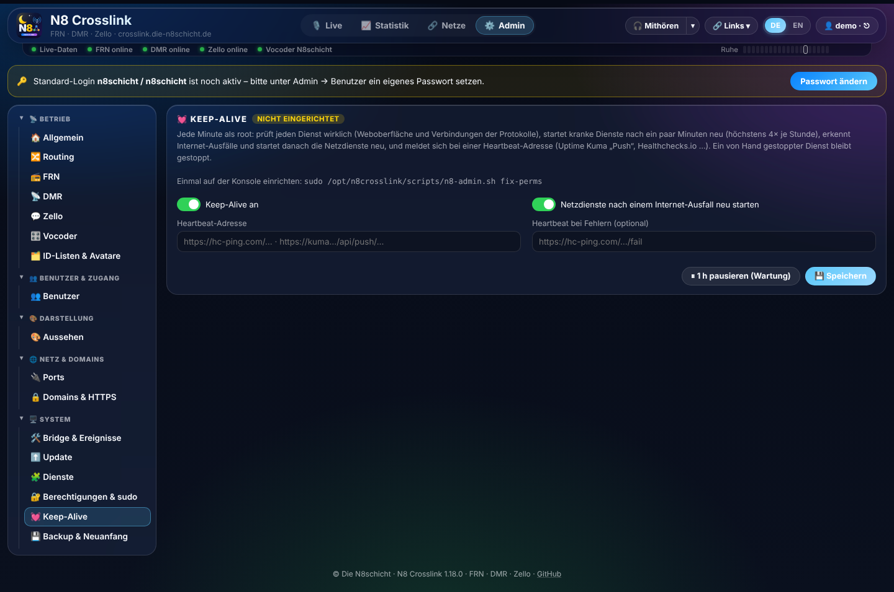
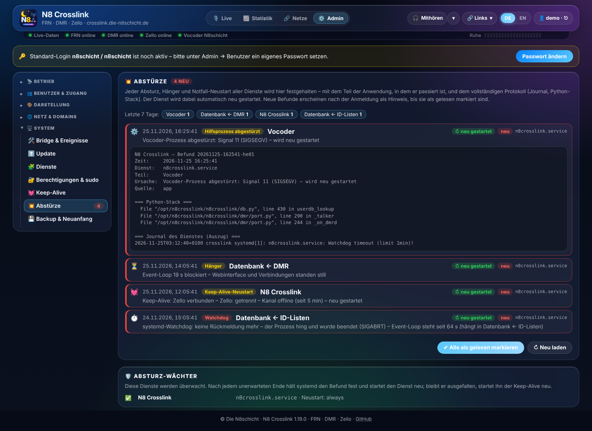
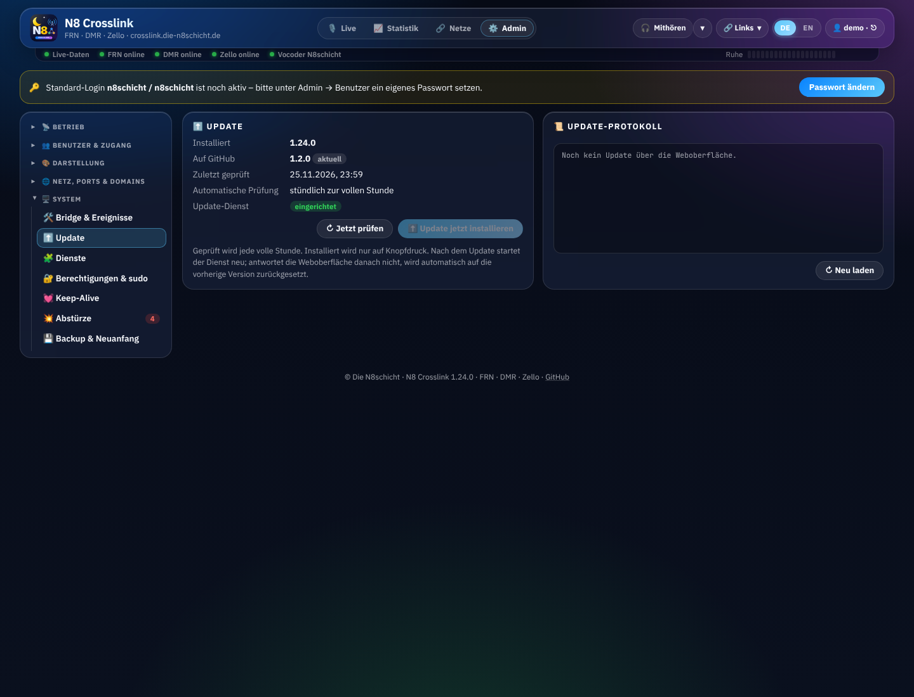
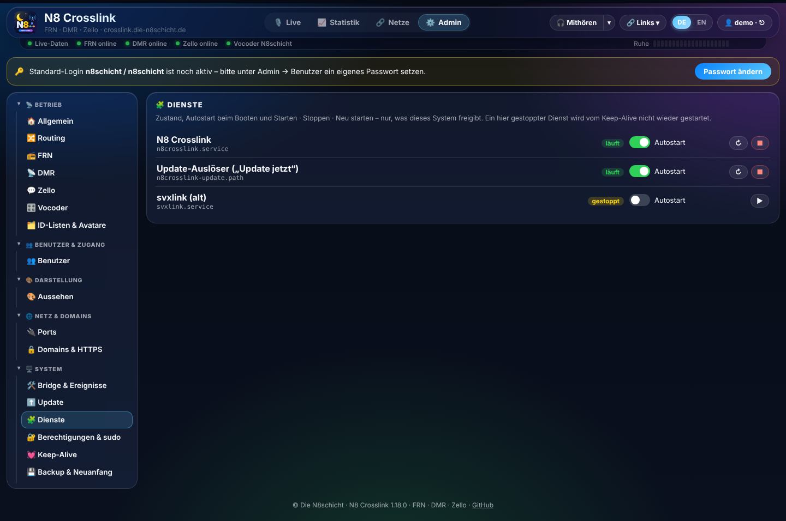
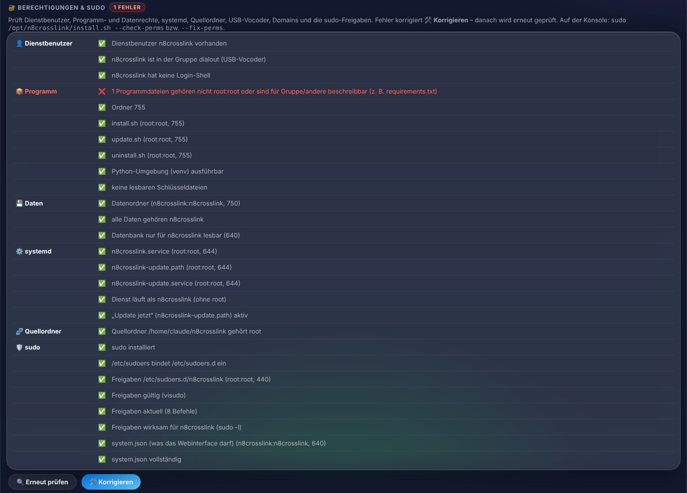
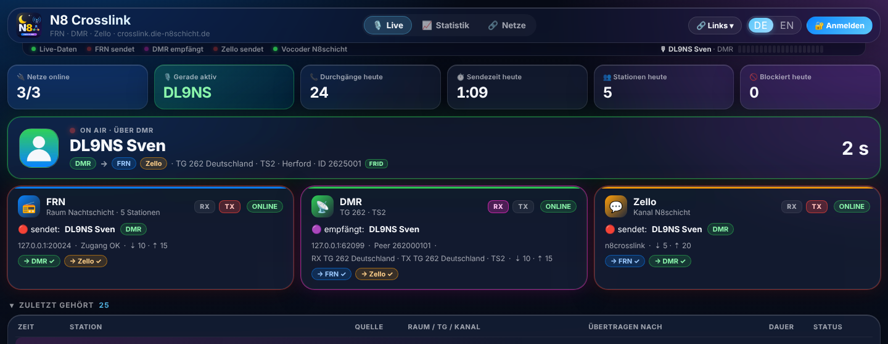

# Betrieb: Watchdogs, Keep-Alive, Abstürze, Updates, sudo & Berechtigungen

## Watchdogs

| Ebene | Was passiert |
|---|---|
| **FRN** | TCP-Keepalive, Polling mit `P`; bricht die Verbindung ab oder kommt 30 s nichts, wird neu verbunden (Backoff 5 s → 2 min, abwechselnd Haupt- und Backup-Server). **Master hat Vorrang:** läuft er auf dem Backup, prüft er jede Minute den Master und kehrt nach 3 erfolgreichen Prüfungen zwischen zwei Durchgängen zurück (siehe *FRN Master & Backup* in KONFIGURATION.md) |
| **DMR** | `RPTPING` alle 5 s; 30 s ohne `MSTPONG` → neuer Login; `MSTNAK`/`MSTCL` → neuer Login; DNS wird bei jedem Neuaufbau neu aufgelöst |
| **Zello** | WebSocket-Heartbeat 30 s; Abbruch oder Kanal „offline“ → neu verbinden (mit Refresh-Token) |
| **Bridge-Watchdog** (alle 10 s) | stirbt die Verbindungsschleife eines Netzes → sofortiger Neuaufbau; ist ein Netz länger als *Watchdog-Zeit* (Standard 120 s) offline → kompletter Neuaufbau (neue Sockets) |
| **Vocoder** | Gesundheitsprüfung alle 20 s; antwortet er 60 s nicht → wird neu geöffnet (z. B. USB-Stick ab- und wieder angesteckt) |
| **systemd** | `WatchdogSec=60`: meldet sich die Bridge nicht mehr (Event-Loop hängt), startet systemd den Dienst neu; `Restart=always` bei Absturz. Das Lebenszeichen kommt seit 1.19.0 aus einer eigenen Aufgabe – ein langsamer Neuaufbau hält es nicht mehr auf |
| **Hintergrundaufgaben** | ID-Listen, Avatare, Update-Prüfung, Aufräumen, Watchdog und Live-Daten werden überwacht und nach einem Fehler nach 5 s neu gestartet (seit 1.19.0) |

Jeder Verbindungsverlust und jede Wiederherstellung steht in den Ereignissen; Zähler (Wiederverbindungen, Neuaufbauten, letzter Grund, online/offline seit) unter **Netze**.

### 💓 Keep-Alive (von außen, als root)



Seit **1.18.0** wacht zusätzlich ein Keep-Alive **von außerhalb** der Bridge – derselbe wie in HobbyRadioPortal, ADN-FRN-Server,
HBlink4-FreeRadioID und N8 Hotspot (N8 Admin-Kit, `scripts/n8-admin.sh`). `n8crosslink-keepalive.timer` startet **jede Minute als root**
`scripts/n8-admin.sh keepalive` und fragt `/api/n8/health` (nur lokal erreichbar):

| Was | Wie |
|---|---|
| **Weboberfläche** | antwortet sie? |
| **FRN · DMR · Zello · Vocoder** | jedes eingeschaltete Netz wirklich verbunden (FRN angemeldet, DMR am Master, Zello im Kanal), Vocoder bereit |
| **Neustart** | die Bridge verbindet sich selbst neu – erst wenn ein Netz **5 Minuten** weg bleibt (oder der Dienst `failed` ist), startet der Keep-Alive `n8crosslink.service` neu, **höchstens 4× je Stunde** |
| **Internet-Ausfall** | 1.1.1.1, 9.9.9.9 und github.com (Port 443) nicht erreichbar → keine sinnlosen Neustarts; ist das Netz nach mindestens 60 s wieder da, wird die Bridge einmal neu gestartet, damit alle drei Netze sofort wieder stehen |
| **Heartbeat** | optional jede Minute ein Ping an Uptime Kuma („Push“) oder Healthchecks.io, bei Fehlern an die Fehler-Adresse |
| **Wartung** | **⏸ 1 h pausieren**; ein unter *Dienste* gestoppter Dienst bleibt gestoppt |

Einstellungen unter **⚙️ Admin → 🖥️ System → 💓 Keep-Alive**; Dateien `data/keepalive.conf`, `keepalive.json`, `keepalive.log`.
Eingerichtet von Installer, Update und `install.sh --fix-perms`.

## 💥 Abstürze erkennen und aufklären



Seit **1.19.0** wird jedes unerwartete Ende festgehalten – in allen N8-Systemen gleich (N8 Kit 1.3, `scripts/n8-admin.sh`):

| Ebene | Was festgehalten wird |
|---|---|
| **Absturz-Wächter** (systemd, als root) | Drop-in `/etc/systemd/system/n8crosslink.service.d/n8-crashwatch-n8crosslink.conf` mit `ExecStopPost=+… crash-hook`. Nach jedem Ende, das nicht geplant war (kein Stoppen/Neustart von Hand, kein Update, kein Keep-Alive, kein Herunterfahren): Art (Signal, Fehlercode, Watchdog, OOM, Zeitüberschreitung), letzte 200 Journal-Zeilen, Coredump-Kurzinfo, Python-Stack. systemd startet den Dienst sofort neu |
| **Bridge: faulthandler** | `data/crash/fault-n8crosslink.service.log` – Python-Stack aller Threads beim harten Ende (SIGSEGV, SIGABRT vom Watchdog, SIGBUS …) |
| **Bridge: Hänger-Wächter** | steht die Event-Loop > 8 s, wird ihr Stack festgehalten und einem Teil zugeordnet: **FRN · DMR · Zello · Vocoder · Audio · Datenbank · ID-Listen · Avatare · Update-Prüfung · Ansage · Backup · Router · Webinterface**. Zwei Teile bedeuten „wartet auf“: *Datenbank ← DMR* |
| **Bridge: Teile** | abgestürzte Verbindungsschleifen, Hintergrundaufgaben, Tasks und Threads (mit Traceback) – der Teil wird neu gestartet, die Bridge läuft weiter |
| **Vocoder-Prozess** | Absturz (Signal) oder Hänger des N8schicht-Vocoders, mit seiner letzten Ausgabe – wird sofort neu gestartet |
| **Keep-Alive** | jeder Neustart durch den Keep-Alive (mit Grund), Dienste im Zustand `failed` (werden mit `reset-failed` neu gestartet), Neustarts durch systemd ohne Absturz-Wächter |

**Anzeigen:** ⚙️ Admin → 🖥️ System → **💥 Abstürze** – Liste mit Art, Teil, Ursache und vollständigem Protokoll zum Aufklappen, Zähler je Teil
(7 Tage, als Filter). Neue Befunde erscheinen **direkt nach der Anmeldung als Hinweisfenster** und als roter Zähler im Menü, bis sie als
gelesen markiert sind. Konsole: `sudo /opt/n8crosslink/scripts/n8-admin.sh crashes`.

**Bereinigen:** In jedem aufgeklappten Befund löscht **🗑 Diesen Befund löschen** ihn samt Protokoll, unten **🗑 Alle löschen**
(mit Rückfrage) alle – ist oben nach einem Dienst gefiltert, heißt der Knopf **🗑 Angezeigte löschen** und löscht nur diese.
Auf der Konsole: `sudo …/scripts/n8-admin.sh crashes-clear`. Die laufende Faulthandler-Datei (`crash/fault-*.log`) bleibt.

Dateien: `data/crashes.jsonl` (eine Zeile je Befund, die letzten 300), `data/crash/<id>.log`, `data/crash/fault-n8crosslink.service.log`, `data/crash/ack.json`
(gelesen), `data/crashwatch.json` (überwachte Dienste). Eingerichtet von Installer, Update und `install.sh --fix-perms`
(von Hand: `sudo /opt/n8crosslink/scripts/n8-admin.sh setup-crashwatch`).

**Auswerten:** Steht im Befund *⏱️ Watchdog* mit *Datenbank ← …*, hing die Event-Loop an der Datenbank; *💥 Absturz durch SIGSEGV* mit
*Audio (GSM/Opus/DSP)* deutet auf eine C-Bibliothek. Das Protokoll eines Befunds kann unverändert an den Entwickler gehen (es enthält keine
Passwörter, aber Rufzeichen und Server-Adressen aus dem Journal).

## Updates

Hinweis, Updates-Seite und Fortschritt kommen aus dem **N8 Kit** und sehen in N8 Crosslink, HBlink4-FreeRadioID, adn-frn-server und N8-HotSpot gleich aus (siehe [SICHERHEIT.md](SICHERHEIT.md#n8-kit)).

* Prüfung **stündlich zur vollen Stunde** (und kurz nach dem Start): Versionsnummer in `n8crosslink/__init__.py` auf GitHub (`dhartmann1979/N8Crosslink`, Branch `main`) gegen die installierte Version.
* Neue Version → Hinweis unter der Statusleiste für angemeldete Admins: *Update verfügbar: 1.6.0 → 1.7.0* mit **Was ist neu?** (aus `CHANGELOG.md`), **Jetzt aktualisieren**, **Details** (öffnet Admin → System → Update) und **Später** (blendet den Hinweis für diese Version einen Tag aus).
* **Jetzt aktualisieren** öffnet ein Fenster mit den Neuerungen; nach der Bestätigung drei Schritte mit Fortschritt: *Update wird geladen und eingespielt → Dienst startet neu → Weboberfläche wird geprüft*. Technisch startet es über sudo `n8crosslink-update.service` (als root) → `update.sh --auto`: Quellen holen, Installer im Update-Modus (Abhängigkeiten, Berechtigungen, sudo-Freigaben), Dienst neu starten, Weboberfläche per HTTP prüfen. Antwortet sie nicht, stellt `update.sh` die vorige Version wieder her. Die Seite lädt danach von selbst neu.
* Ergebnis unter **Admin → System → ⬆️ Update** (Kachel *Update-Protokoll*) (*erfolgreich* oder *zurückgenommen*), gespeichert in `data/update.result` – dasselbe Format wie in den anderen N8schicht-Projekten.
* Ersatzweg ohne sudo: `n8crosslink-update.path` reagiert auf `data/update.request`.



## Dienste

**⚙️ Admin → 🖥️ System → 🧩 Dienste** zeigt schlank alle freigegebenen Dienste: Status (läuft / gestoppt / Fehler), **Autostart** als Schalter
(aktivieren/deaktivieren beim Booten) und je nach Zustand **🔄 Neu starten** und **⏹ Stoppen** oder **▶ Starten**. Dabei sind
`n8crosslink.service`, der Update-Auslöser `n8crosslink-update.path` und erkannte alte Dienste (svxlink, mmdvm_bridge, analog_bridge,
ambeserver, Zello-Bridge). Stoppen oder Autostart aus fragt nach; wer N8 Crosslink selbst stoppt, startet es danach nur auf der Konsole wieder
(`sudo systemctl start n8crosslink`).



## sudo – alles über das Webinterface

Die Bridge läuft als eigener Benutzer **ohne** root-Rechte. Damit trotzdem alles im Webinterface geht, schreibt der Installer `/etc/sudoers.d/n8crosslink` mit **einzelnen, vollständigen Befehlen** (keine Shell; einziger Platzhalter ist `n8x-certs.sh *`, der Helfer prüft jede Eingabe selbst), z. B.

```
n8crosslink ALL=(root) NOPASSWD: /usr/bin/systemctl --no-block restart n8crosslink.service
n8crosslink ALL=(root) NOPASSWD: /usr/bin/systemctl --no-block start n8crosslink-update.service
n8crosslink ALL=(root) NOPASSWD: /opt/n8crosslink/install.sh --build-vocoder
n8crosslink ALL=(root) NOPASSWD: /opt/n8crosslink/install.sh --fix-perms
n8crosslink ALL=(root) NOPASSWD: /opt/n8crosslink/install.sh --check-perms --json
```

Freigegeben werden: für die eigenen Dienste `n8crosslink.service` und `n8crosslink-update.path` Starten, Stoppen, Neustarten, Autostart an/aus, Bauen des N8schicht-Vocoders (`install.sh --build-vocoder`), Update-Dienst und die bei der Installation erkannten alten Dienste (Start/Stopp/Neustart/Autostart), Berechtigungsprüfung (`--check-perms --json`) und -korrektur (`--fix-perms`), Domains & HTTPS (`n8x-certs.sh`) und – nur wenn bei der Installation bestätigt – `systemctl reboot`. Die Datei wird vor dem Einspielen mit `visudo` geprüft und bei jedem Update neu erzeugt. Alles andere (Shell, andere Dienste) ist verboten.

**Sandbox des Dienstes:** `n8crosslink.service` läuft mit `ProtectSystem=full` – `/etc` und `/usr` sind für den Dienst schreibgeschützt, und das
erbt auch alles, was er per sudo startet. Die root-Helfer (`install.sh --fix-perms/--check-perms/--build-vocoder`, `n8x-certs.sh`) erkennen das
(`/etc` nicht beschreibbar) und starten sich ab 1.14.1 als eigener kurzlebiger systemd-Dienst **außerhalb der Sandbox** neu
(`systemd-run --wait --pipe --collect`); Ausgabe und Rückgabewert kommen ans Webinterface zurück. Der Schutz des Dienstes bleibt so an.

## Berechtigungen & sudo prüfen und korrigieren

Programm, venv und Skripte gehören root und sind für den Dienst nur lesbar – wichtig, weil `update.sh` als root läuft. Nur `data/` gehört dem Dienst.
Ab 1.14.0 gibt es dafür einen **Berechtigungsprüfer**, der jede Regel einzeln meldet, gezielt korrigiert und danach erneut prüft:

```bash
sudo /opt/n8crosslink/install.sh --check-perms     # nur prüfen, ändert nichts (Rückgabe 1 = Fehler gefunden)
sudo /opt/n8crosslink/install.sh --fix-perms       # prüfen → korrigieren (auch sudo) → erneut prüfen
```

Im Webinterface: **⚙️ Admin → 🖥️ System → 🔐 Berechtigungen & sudo** – die Liste wird beim Öffnen geprüft, **🛠️ Korrigieren** repariert
und zeigt das Ergebnis der zweiten Prüfung.



| Bereich | Geprüft wird | Korrektur |
|---|---|---|
| 👤 Dienstbenutzer | `n8crosslink` vorhanden, in Gruppe `dialout`, ohne Login-Shell (nur Hinweis) | Gruppe ergänzen |
| 📦 Programm | alles unter `/opt/n8crosslink` außer `data/` gehört `root:root`, nicht für Gruppe/andere beschreibbar; Ordner 755; `install.sh`, `update.sh`, `uninstall.sh`, `n8x-certs.sh` 755; venv ausführbar; keine lesbaren `*.key`/`*.pem`; kein `.cache` | Besitzer/Rechte setzen, Schlüsseldateien in die Datenbank übernehmen |
| 💾 Daten | `data/` gehört `n8crosslink`, 750; Datenbank 640; `update.log` 644 | Besitzer/Rechte setzen |
| ⚙️ systemd | `n8crosslink.service`, `-update.path`, `-update.service` vorhanden, `root:root` 644; Dienst läuft als `n8crosslink`; „Update jetzt“ aktiv | fehlende Units einspielen, Rechte setzen, `n8crosslink-update.path` aktivieren |
| 🧬 Quellordner | Git-Quelle (daraus installiert `update.sh` als root) gehört root, nicht beschreibbar | Besitzer setzen |
| 🔌 USB-Vocoder | Betriebsart USB: Gerät vorhanden, Dienstbenutzer in dessen Gruppe | Gruppe ergänzen |
| 🔒 Domains & HTTPS | `/var/www/n8crosslink-acme` 755, nginx-Seiten `n8crosslink*` `root:root` 644 | Rechte setzen |
| 🛡️ sudo | sudo installiert; `/etc/sudoers` bindet `/etc/sudoers.d` ein; `/etc/sudoers.d/n8crosslink` `root:root` 440, gültig (`visudo`), **aktuell** (Vergleich mit den Freigaben, die der Installer jetzt schreiben würde), **wirksam** (`sudo -l -U n8crosslink`); `data/system.json` vorhanden, 640, vollständig | sudo installieren, `@includedir` ergänzen (mit `visudo` geprüft), Freigaben und `system.json` neu schreiben |

Installer und Update rufen am Ende dieselbe Prüfung auf. Ist sudo noch gar nicht eingerichtet (z. B. von Hand gelöscht), kann das
Webinterface nichts reparieren – dann einmal auf der Konsole `sudo /opt/n8crosslink/install.sh --fix-perms`; die Seite zeigt diesen Hinweis.

## LEDs in Statusleiste und Netzkarten

| Farbe | Bedeutung |
|---|---|
| 🔴 **Rot** (blinkt) | das Netz **sendet** gerade (Bridge → FRN/DMR/Zello), Chip **TX** leuchtet rot |
| 🟣 **Magenta** (blinkt) | das Netz **empfängt** gerade (Durchsage kommt von dort), Chip **RX** leuchtet magenta, die Netzkarte glüht magenta |
| 🟢 **Grün** | Dienst ok – verbunden, bereit |
| 🟡 **Gelb** | Netz ausgeschaltet |
| 🔴 **Rot** (ruhig) | Netz offline / nicht verbunden |

Bis 1.11 war Empfangen grün – das ließ sich nicht von „Dienst ok“ unterscheiden.



