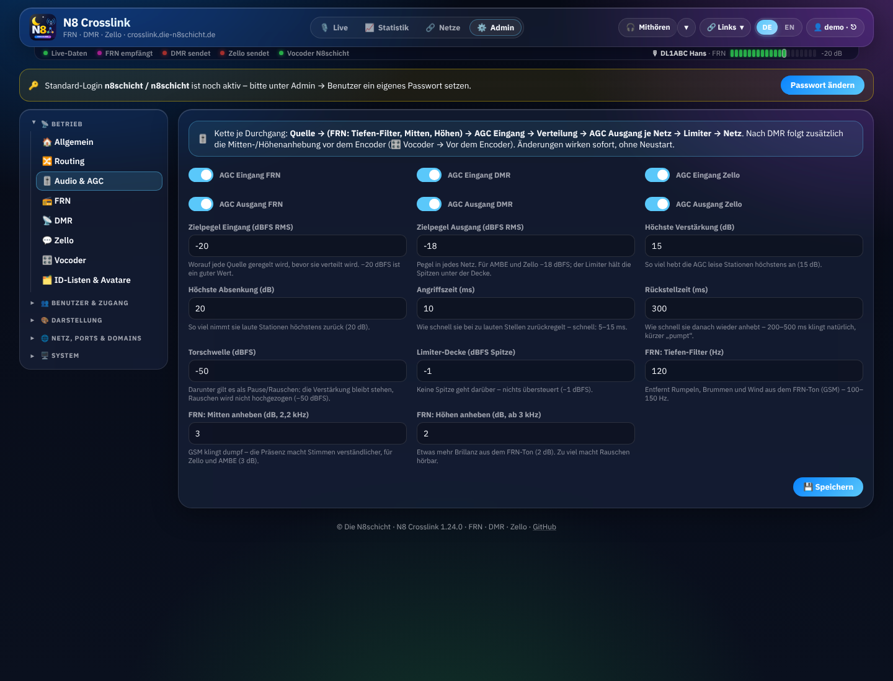
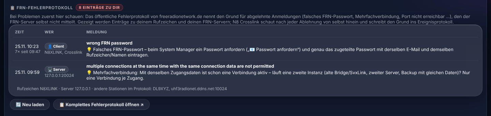
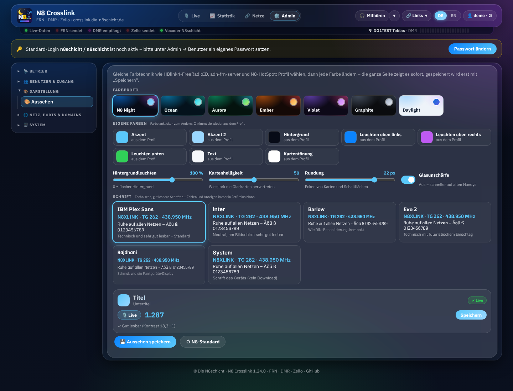
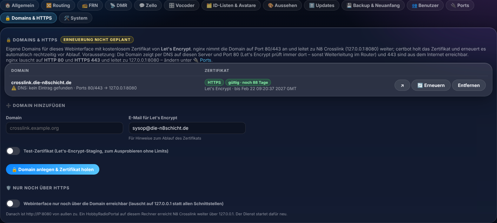
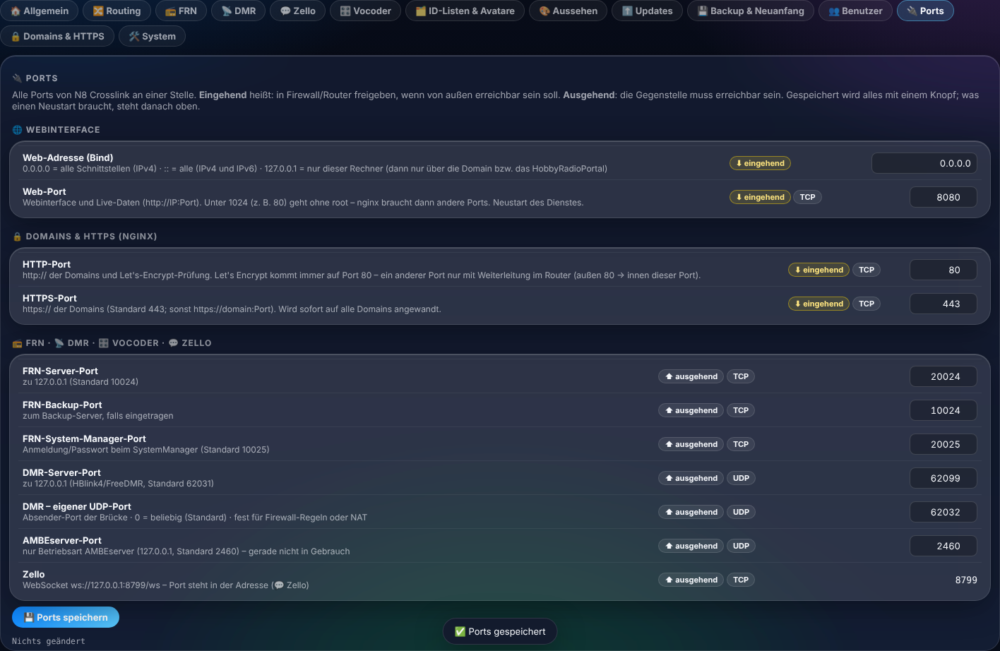

# Konfiguration / Adminportal

Anmelden über **🔐 Anmelden** oben rechts – Standard **n8schicht / n8schicht**. Solange er gilt, sind Änderungen gesperrt, bis das Passwort unter *👥 Benutzer & Zugang* geändert ist. Angemeldet zeigt die Kopfleiste **Avatar + Name ▾** mit ⚙️ Adminbereich und ⏻ Abmelden.

Seit **1.18.0** steht links ein **Baum-Menü** – dasselbe wie in ADN-FRN-Server, HBlink4-FreeRadioID und N8 Hotspot:
**📡 Betrieb** (Allgemein, Routing, FRN, DMR, Zello, Vocoder, ID-Listen & Avatare) · **👥 Benutzer & Zugang** (Benutzer) ·
**🎨 Darstellung** (Aussehen) · **🌐 Netz & Domains** (Ports, Domains & HTTPS) · **🖥️ System** (Bridge & Ereignisse, Update, Dienste,
Berechtigungen & sudo, Keep-Alive, Backup & Neuanfang). Alle Gruppen sind anfangs zugeklappt – offen ist nur die Gruppe der gewählten Seite. Auf dem Handy wird das Menü zu einer aufklappbaren Leiste. Alle Werte liegen in SQLite (`/opt/n8crosslink/data/crosslink.db`); Passwörter werden nie im Klartext angezeigt (Feld leer lassen = unverändert).

## 🏠 Allgemein
| Feld | Bedeutung |
|---|---|
| Sperrzeit nach Aussendung | Nach dem Ende einer Durchsage nimmt die Bridge so lange nichts aus den Zielnetzen an (Ping-Pong-Schutz). Standard 600 ms |
| Vorpuffer DMR/Zello | Puffer vor dem Senden. FRN liefert 200-ms-Blöcke über TCP, daher 240 ms Standard. Hörbare Lücken → erhöhen |
| Time-Out-Timer | Maximale Dauer eines Durchgangs (Standard 180 s) |
| Hinweis-Banner / Links | erscheinen im Dashboard |
| Watchdog | Netz nach so vielen Sekunden offline komplett neu aufbauen (Standard 120 s) |
| Updateprüfung | stündlich zur vollen Stunde, Repository und Branch einstellbar |

Diese Werte wirken sofort; Web-Adresse und -Port erst nach *Dienst neu starten*.

### 🔊 Sprachansage des Rufzeichens (Standard: aus)
Am Anfang eines Durchgangs sagt eine Computerstimme (espeak-ng, offline, wird vom Installer mitinstalliert) das Rufzeichen der Station an; danach folgt der Ton. Das hören alle – egal mit welchem Programm sie zuhören.

| Feld | Bedeutung |
|---|---|
| Ansage nach FRN / DMR / Zello | in welche Netze angesagt wird (Standard nur FRN) |
| Rufzeichen sprechen als | Buchstaben („De O Eins Te E Es Te“) oder NATO-Alphabet („Delta, Oscar, Eins …“) |
| Ansagetext | `{call}` = Rufzeichen, `{name}` = Name, z. B. `{call} {name}` |
| Je Station höchstens alle … Minuten | 0 = bei jedem Durchgang; z. B. 10 = nur beim ersten Durchgang nach 10 Minuten Pause |
| Auch ohne Rufzeichen | Stationen ohne Rufzeichen (z. B. Zello-Namen) mit dem Namen ansagen |
| Tempo, Lautstärke, Pause | Feinabstimmung; mit **▶ Ansage anhören** sofort im Browser probehören |

Wichtig: Der ganze Durchgang läuft um die Länge der Ansage verzögert (Buchstaben bei 7 Zeichen ≈ 2 s, NATO länger). Die Ansage wird im 20-ms-Takt vor den Ton gesetzt; folgt gleich der nächste Durchgang, wird der Rest sofort ausgegeben. Ohne bekanntes Rufzeichen (und ohne „Auch ohne Rufzeichen“) gibt es keine Ansage.


## 🔀 Routing
Matrix mit allen sechs Richtungen. Wirkt sofort, ohne Neustart.

## 🎚️ Audio & AGC
Klangaufbereitung der ganzen Bridge – **wirkt sofort, ohne Neustart**. Kette je Durchgang:

```
Quelle ─▶ [nur FRN: Tiefen-Filter · Mitten · Höhen] ─▶ AGC Eingang ─▶ Verteilung ─┬▶ AGC Ausgang FRN   ─▶ Limiter ─▶ FRN
                                                                                ├▶ AGC Ausgang DMR   ─▶ Limiter ─▶ (Mitten/Höhen + Limiter vor dem Encoder) ─▶ AMBE
                                                                                └▶ AGC Ausgang Zello ─▶ Limiter ─▶ Opus
```

| Einstellung | Standard | Wirkung |
|---|---|---|
| AGC Eingang FRN / DMR / Zello | an | Regelt jede Quelle auf den Eingangs-Zielpegel – leise und laute Stationen kommen gleich laut an |
| AGC Ausgang FRN / DMR / Zello | an | Regelt noch einmal je Netz auf den Ausgangs-Zielpegel (z. B. optimal für AMBE und Opus) |
| Zielpegel Eingang | −20 dBFS RMS | Worauf die Quelle geregelt wird |
| Zielpegel Ausgang | −18 dBFS RMS | Pegel in jedes Netz |
| Höchste Verstärkung / Absenkung | 15 dB / 20 dB | Grenzen der Regelung |
| Angriffszeit | 10 ms | Wie schnell zu laute Stellen zurückgeregelt werden (schnelle AGC, Regelschritt 5 ms) |
| Rückstellzeit | 300 ms | Wie schnell danach wieder angehoben wird – kürzer „pumpt“ |
| Torschwelle | −50 dBFS | Darunter gilt es als Pause/Rauschen: die Verstärkung bleibt stehen, Rauschen wird nicht hochgezogen |
| Limiter-Decke | −1 dBFS Spitze | Keine Spitze geht darüber, nichts übersteuert |
| FRN: Tiefen-Filter | 120 Hz | Entfernt Rumpeln, Brummen, Wind aus dem GSM-Ton |
| FRN: Mitten anheben | +3 dB (2,2 kHz) | GSM klingt dumpf – mehr Verständlichkeit für Zello und AMBE |
| FRN: Höhen anheben | +2 dB (ab 3 kHz) | Etwas mehr Brillanz |

Die AGC startet bei jedem Durchgang neu (0 dB). Die Pegelregler je Netz (*RX/TX-Pegel* bei FRN, DMR, Zello) wirken weiterhin
zusätzlich – mit AGC können sie meist auf 0 dB bleiben. Wer den alten Klang will, schaltet die sechs AGC-Schalter aus und setzt die
drei FRN-Werte auf 0.



## 📻 FRN
Server, Backup-Server, Konto, Rufzeichen/Name (erscheint im FRN-Raum als „Rufzeichen, Name“), Client-Typ (0 = Crosslink, 1 = Gateway, 2 = PC Only), Band/Kanal, Raum. *Ende-Erkennung RX* ist die Zeit ohne Sprachpaket, nach der ein Durchgang als beendet gilt. 

### 🏠 Raum aus dem Auswahlmenü
**Raum (Net)** ist ein Auswahlmenü mit den Räumen des eingetragenen FRN-Servers (mit Anzahl der Stationen, wenn bekannt).
Die Liste wird beim Öffnen von *FRN* und nach jeder Änderung von Server/Port ausgelesen, **🔄** liest sie neu. Quellen:

1. **aktuelle Verbindung** – ist der Crosslink mit diesem Server verbunden, nimmt er die Raumliste, die der Server nach dem Login schickt;
2. **Dashboard** – hat der Server ein ADN-FRN-Server-Dashboard, kommt die Liste von dort (mit Stationszahl, ohne versteckte Räume);
3. **kurze FRN-Anmeldung** – sonst meldet sich der Crosslink mit dem eingetragenen Konto kurz an, liest die Liste und meldet sich ab.
   Das passiert nicht, solange er mit demselben Konto schon online ist (der System Manager erlaubt jedes Konto nur einmal).

Ein versteckter oder neuer Raum, der nicht in der Liste steht: **✏️ Anderer Raum …** wählen und den Namen eintippen.

### 🔁 FRN Master & Backup – Master hat immer Vorrang

Mit **„Master & Backup erkennen, Master hat Vorrang“** (Standard an) fragt der Crosslink das Dashboard des FRN-Servers
(ADN-FRN-Server ab 2.21, öffentliches `/api/info`), wer **Master** und wer **Backup** ist – z. B. Master
`frn.auf-der-nachtschicht.de`, Backup `frn-backup.auf-der-nachtschicht.de`. Dann gilt, egal welcher der beiden unter *Server* steht:

- **Master ist Priorität 1.** Beim Start und nach jeder Störung wird zuerst der Master versucht.
- **Fällt der Master aus**, geht es zum Backup (abwechselnd, Backoff 5 s → 2 min). Im Ereignisprotokoll und auf der FRN-Karte steht,
  auf welchem Server der Crosslink gerade ist („· Master“ / „· Backup“).
- **Läuft der Crosslink auf dem Backup**, prüft er **jede Minute**, ob der Master wieder wirklich bereit ist: FRN-Port erreichbar,
  Java-FRN-Server läuft (`/api/live`), keine Ablehnung durch den SystemManager, keine Wartung („An das Backup übergeben“). Nach
  **3 erfolgreichen Prüfungen hintereinander** wechselt er **zwischen zwei Durchgängen** (wartet höchstens 2 Minuten auf eine Pause)
  zurück zum Master: „FRN: Master … ist wieder bereit – wechsle vom Backup zurück zum Master“.
- Die Erkennung wird alle 10 Minuten und nach jeder Störung aufgefrischt; ändert sich die Rolle, folgt der Crosslink.
- Tipp: Trag zusätzlich den **Backup-Server** ein. Dann findet der Crosslink das Backup auch, wenn der Master samt Dashboard beim
  Start schon nicht erreichbar ist.
- Ohne ADN-Dashboard (anderer FRN-Server) oder mit ausgeschalteter Erkennung gilt wie bisher *Server* vor *Backup-Server*; die
  Rückkehr prüft dann nur, ob der FRN-Port des Servers erreichbar ist.

### 📋 FRN-Fehlerprotokoll – bei Problemen immer zuerst hier

Lehnt der FRN-Server die Anmeldung ab oder trennt er, nennt er den Grund meist nicht. Den schreibt der FRN System Manager in das
**öffentliche FRN-Fehlerprotokoll** von freeradionetwork.de (dort im Seitenmenü *Hilfe → Fehlerprotokoll*, direkt:
<http://log.freeradionetwork.de:60080/error_log.php>). N8 Crosslink nutzt es an drei Stellen (ab 1.15.0):

* **Admin → 📻 FRN → 📋 FRN-Fehlerprotokoll:** Einträge zu deinem **Rufzeichen** (Client) und deinen **FRN-Servern** (Server und
  Backup-Server) aus den letzten Einträgen des Protokolls – gleiche Meldungen zusammengefasst („7× seit 09:47“), mit deutscher Erklärung, was zu
  tun ist. Darunter **🔄 Neu laden** und **📋 Komplettes Fehlerprotokoll öffnen**.
* **Automatisch:** Nach jeder Ablehnung (`WRONG`/`BLOCK`), Trennung oder fehlgeschlagenen Verbindung schaut N8 Crosslink nach ein paar Sekunden ins
  Protokoll (höchstens alle 2 Minuten) und schreibt den Grund ins **Ereignisprotokoll**, z. B.
  `FRN-Fehlerprotokoll (Login abgelehnt): Client N8XLINK, Crosslink – wrong FRN password → Falsches FRN-Passwort – …`.
* **Diagnose:** `sudo /opt/n8crosslink/install.sh --diagnose` gibt die Einträge zu Rufzeichen und Servern mit aus.



| Meldung im Protokoll | Bedeutung / was tun |
|---|---|
| `wrong FRN password` | Falsches FRN-Passwort – **📧 Passwort anfordern** und genau das zugeteilte Passwort mit derselben E-Mail und demselben Rufzeichen/Namen eintragen |
| `multiple connections at the same time with the same connection data are not permitted` | Mit denselben Zugangsdaten läuft schon eine Verbindung – zweite Instanz (alte Bridge, SvxLink, zweiter Server, Backup mit gleichen Daten) beenden |
| `not listening on specified port` | (Server) Port von außen nicht erreichbar – Firewall und Portweiterleitung (TCP) prüfen |

Das Protokoll zeigt nur die letzten etwa 100 Fehler des ganzen FRN-Netzes; ist es nicht erreichbar (Port 60080 ausgehend gesperrt), steht das als
Hinweis da.

### 💬 Sprechername als Textnachricht
Ist *Sprechername als FRN-Textnachricht* an, schickt die Bridge vor jedem Durchgang aus DMR/Zello eine Textnachricht wie „DO1TEST Tobias (DMR)“.

* *Textnachricht nur an diese Stationen (privat)* leer = **öffentlich an alle** im Raum (FRN-Befehl `TM:` mit leerer `<ID>`).
* Mit Rufzeichen (Komma-Liste, z. B. `DL1ABC, DB0XYZ`) geht die Nachricht **privat** nur an diese Stationen (`<ID>` = deren Client-ID aus der Raumliste). Bei allen anderen ploppt nichts auf. Einen stillen „Info“-Nachrichtentyp kennt das FRN-Protokoll nicht.

Operator (`<ON>`) und Beschreibung (`<DS>`) überträgt FRN nur bei der Anmeldung; ein Operator-Wechsel per Neuanmeldung (1.5.0) hat in der Praxis nicht funktioniert und ist ab 1.6.0 wieder entfernt.

### 📧 FRN-Passwort anfordern
Wer noch kein FRN-Konto hat: Rufzeichen, Name, E-Mail, Band/Kanal, Land und Ort („Ort - Ortsteil“) ausfüllen und **„📧 Passwort anfordern“** klicken. Die Werte aus dem Formular werden auch ohne Speichern genommen. Die Bridge registriert die Station beim **System Manager** (Standard `sysman.freeradionetwork.eu:10025`, einstellbar für eigene FRN-Netze), genauso wie das SvxLink-Skript `frn-register`. Ein Popup zeigt das Ergebnis:

| Popup | Bedeutung |
|---|---|
| ✅ Passwort angefordert | Registrierung angenommen – das Passwort kommt per E-Mail (auch Spam-Ordner prüfen), dann ins Feld „Passwort (FRN)“ eintragen und speichern |
| ⚠️ Bereits registriert | Rufzeichen/E-Mail ist schon vergeben – vorhandenes Passwort verwenden |
| ⚠️ Eingaben prüfen | z. B. ungültige E-Mail, Band/Kanal nicht im Format „PC Only“ / „Crosslink“ / „446.03125FM CTC131.8“, Ort ohne „ - “ – es wurde nichts gesendet |
| ⚠️ Keine Verbindung / Keine Antwort | System Manager nicht erreichbar |
| ⚠️ Abgelehnt | System Manager lehnt die Daten ab (Antwortcode wird angezeigt) |

Pro Minute ist eine Anforderung möglich.

## 📡 DMR
| Feld | Bedeutung |
|---|---|
| Peer-ID / Passwort | Zugang am HBlink4/FreeDMR |
| Peer-ID / Passwort bei HBlink4-FreeRadioID | Ist am Server der FreeRadioID-Secure-Login aktiv, macht die lokale Passphrase die Bridge zum **Gast**: Empfang geht, Senden nur in die Gast-Talkgroups. Für Senden in andere TGs das persönliche FreeRadioID-Passwort der Peer-ID verwenden oder das Muster der Bridge am Server von FreeRadioID ausnehmen (siehe [Fehlersuche](FEHLERSUCHE.md)) |
| Quell-ID | DMR-ID, mit der Durchsagen aus FRN/Zello gesendet werden |
| Rufzeichen → eigene DMR-ID | Wenn das Rufzeichen des Sprechers in der ID-Datenbank steht, wird dessen ID als Quelle benutzt (aus = immer Quell-ID) |
| Empfangs-/Sende-TG, Zeitschlitz | 0 als Empfangs-TG = alle Gruppenrufe auf dem Zeitschlitz |
| RPTO | Optionen beim Login, z. B. `TS2=262` |
| Talker Alias | Stationsname im Sprachrahmen (Embedded LC, max. 31 Zeichen 7-Bit) – Funkgeräte zeigen ihn an |
| DMRA-Pakete | Talker Alias zusätzlich als Netzpaket. **Für HBlink4 ausgeschaltet lassen** – HBlink4 beantwortet DMRA mit MSTNAK |

## 💬 Zello
**Private Key:** Liegt eine Datei `zello*.key`/`zello*.pem` im Programm-, Daten- oder Quellordner, übernimmt Installer/Update/Berechtigungsprüfung sie automatisch: sicher verschieben (nur root) → in SQLite übernehmen → per Fingerabdruck gegenprüfen → Datei mit `shred` löschen. Gelesen wird der Schlüssel nur noch aus der Datenbank (und er ist im verschlüsselten Backup). Von Hand: `sudo /opt/n8crosslink/install.sh --fix-perms`. Fingerabdruck anzeigen: `… cli zello-key-info`.

**Schritt-für-Schritt-Anleitung: [ZELLO.md](ZELLO.md).** Kurz: Server (`wss://zello.io/ws` bzw. `wss://zellowork.io/ws/NETZ`), Kanal, Konto, Authentifizierung: *Entwickler-Token* (30 Tage gültig, von developers.zello.com), *Issuer + Private Key* (die Bridge erzeugt selbst JWTs – für den Dauerbetrieb) oder *keine* (Zello Work). Text-Vorlage für den Sprechernamen mit `{name}`, `{callsign}`, `{source}`, `{detail}`.

## 🗂️ ID-Listen & Avatare
| Quelle | Verwendung |
|---|---|
| FreeRadioID `subscriber_ids.csv` (Ersatz `.json`, dann RadioID.net) | alle DMR-IDs → Rufzeichen + Vorname in Last Heard, On Air, Talker Alias |
| FreeRadioID `local_subscriber_ids.json` (Ersatz `.csv`) | bei FreeRadioID registrierte IDs → **FRID**-Kennzeichen, Avatare |
| FreeRadioID `dmr/user/?id=` | unbekannte ID wird live nachgeschlagen, der Name erscheint noch während der Durchsage |
| `n8schicht/talkgroup_ids.json` | Talkgroup-Namen (z. B. „TG 262 Deutschland“) |

Aktualisierung 1× täglich automatisch und per **„ID-Listen jetzt aktualisieren“**.

**Avatare** liegen in SQLite (192 px WebP) und werden 1× täglich oder per **„Avatare jetzt aktualisieren“** neu geladen:
* **DMR:** FreeRadioID-Profilbild (`idimg-<ID>.png`); der graue Platzhalter wird erkannt und nicht gespeichert.
* **FRN:** Rufzeichen → ID aus der Liste → FreeRadioID-Bild.
* **Zello:** Die Zello Channel API liefert keine Profilbilder. Daher: 1. eigenes Bild hochladen (pro Zello-Benutzer), 2. optionale URL-Vorlage mit `{username}`, 3. enthält der Zello-Name ein Rufzeichen (z. B. `dl1abc_hans`), dessen FreeRadioID-Bild.

## 💾 Backup & Neuanfang
Nur für Superadmins. Bietet ein verschlüsseltes Backup zum Download, die Wiederherstellung (vorher prüfen) und das Zurücksetzen in drei Stufen. Wichtig: Der Schlüssel des Backups ist das Superadmin-Passwort, siehe [BACKUP.md](BACKUP.md) und [DEINSTALLATION.md](DEINSTALLATION.md).

## 🎧 Mithören
Angemeldete Admins sehen oben im Menü (neben *Links*) den Knopf **„🎧 Mithören“**; der kleine Pfeil **▾** rechts daran öffnet die **Lautstärke** (0–200 %, wird im Browser gemerkt). Der Ton der gerade aktiven Durchsage kommt aus jedem Netz (FRN, DMR oder Zello) als 8-kHz-Audio über einen eigenen, per Login geschützten WebSocket. Ohne Anmeldung wird die Verbindung abgelehnt, beim Abmelden endet das Mithören.

## 🎨 Aussehen
Dieselbe Farbtechnik (**N8 Theme 2**) wie HBlink4-FreeRadioID, adn-frn-server und N8-HotSpot: sieben Farbprofile (N8 Night, Ocean, Aurora, Ember, Violet, Graphite, Daylight), jede Farbe einzeln (Akzent, Akzent 2, Hintergrund, drei Leuchtfarben, Text, Kartentönung), dazu Hintergrundleuchten, Kartenhelligkeit, Rundung und Glasunschärfe. Die ganze Seite zeigt Änderungen sofort; **💾 Aussehen speichern** übernimmt sie (gespeichert in der Datenbank, Abschnitt `general.theme`), **↺ N8-Standard** setzt zurück. Wer in einem anderen N8-Dashboard schon ein Farbschema hat, stellt hier dieselben Werte ein – dann sehen alle Seiten gleich aus.



### 🔤 Schrift (N8 Theme 2.1)

Unter *Darstellung → 🎨 Aussehen* gibt es jetzt eine **Schriftauswahl mit Vorschau** – jede Karte zeigt Rufzeichen, TG, Frequenz,
Umlaute und Ziffern in ihrer Schrift; ein Klick wirkt sofort auf der ganzen Seite, gespeichert wird mit dem Aussehen.

| Schrift | Charakter |
|---|---|
| **IBM Plex Sans** (Standard) | technisch, sehr gut lesbar |
| Inter | neutral, am Bildschirm sehr gut lesbar |
| Barlow | wie DIN-Beschilderung, kompakt |
| Exo 2 | technisch mit futuristischem Einschlag |
| Rajdhani | schmal, wie ein Funkgeräte-Display |
| System | Schrift des Geräts (kein Download) |

Zahlen, Anzeigen und Code stehen immer in **JetBrains Mono** (CSS-Variable `--n8-mono`). Alle Schriften liegen im Projekt
(`fonts/` neben `n8-theme.js`, SIL Open Font License 1.1) – es gibt keine Anfrage an Google Fonts oder andere fremde Server.
Gleich in allen N8-Systemen.

## 🌐 Sprache
Oben rechts neben *Links* stellt das Sprachmenü **🌐 DE ▾** die Oberfläche auf eine von neun Sprachen um (Deutsch, English, Français, Français (Belgique), Magyar, Svenska, Nederlands, Italiano, Español) – beim ersten Besuch die Sprache des Browsers, sonst Deutsch. Die Wahl gilt sofort und per Cookie für alle N8schicht-Seiten auf demselben Server. Mehr in [SICHERHEIT.md](SICHERHEIT.md#sprache--neun-sprachen).


## ⬆️ Update (System)
Dieselbe Ansicht wie in allen N8-Systemen: installiert, auf GitHub, zuletzt geprüft, automatische Prüfung, letztes Update (erfolgreich/zurückgenommen), Update-Dienst, Neuerungen, **↻ Jetzt prüfen**, **⬆️ Update jetzt installieren** (ohne Passwort) und daneben das Update-Protokoll. Ablauf und Rollback: [BETRIEB.md](BETRIEB.md#updates).

## 🎛️ Vocoder
Betriebsart (N8schicht-Vocoder, USB-Stick, AMBEserver, Test), Pegel und Watchdog. Beim N8schicht-Vocoder öffnet **🎚️ Klang-Einstellungen** auf der Karte ein Popup mit Reglern (wirken sofort), Grundabstimmung und Probehören – alle Regler erklärt in [VOCODER.md](VOCODER.md#-klang-einstellungen-popup).


## 🔒 Domains & HTTPS

Eigene Domains für das Webinterface mit kostenlosem **Let's-Encrypt-Zertifikat** – ohne Konsole (ab 1.12.0).



1. Fehlen nginx und certbot, steht oben **📦 Benötigte Pakete installieren** – ein Klick installiert `nginx` und `certbot` und
   schaltet die automatische Erneuerung (certbot-Timer) ein.
2. Unter **➕ Domain hinzufügen** die Domain (z. B. `crosslink.example.org`) und die **E-Mail für Let's Encrypt** eintragen →
   **🔒 Domain anlegen & Zertifikat holen**. nginx nimmt die Domain auf dem **HTTP-** und **HTTPS-Port** aus
   [🔌 Ports](#-ports) an (Standard 80/443) und leitet zu N8 Crosslink (`127.0.0.1:<Web-Port>`, mit WebSocket) weiter; certbot holt das
   Zertifikat über eine Prüfdatei (webroot) und http:// leitet danach auf https:// um. Die Zeile je Domain zeigt die Ports; passen sie nicht
   mehr zu den Einstellungen, erscheint **🔁 Ports auf alle Domains anwenden**.
3. Die Liste zeigt je Domain, wohin der DNS-Eintrag zeigt, ob HTTPS aktiv ist, das Zertifikat (Aussteller, Ablaufdatum, Resttage –
   rot unter 14 Tagen) und die Knöpfe **🔄 Erneuern**, **🔒 Zertifikat holen** (falls es beim ersten Mal nicht geklappt hat) und **Entfernen**
   (Weiterleitung und Zertifikat).
4. **Test-Zertifikat** nutzt die Staging-Umgebung von Let's Encrypt – zum Ausprobieren, ohne in die Limits zu laufen (Browser warnen bei
   diesen Zertifikaten).
5. **🛡️ Nur noch über HTTPS:** stellt die Web-Adresse auf `127.0.0.1` – dann ist `http://IP:Port` von außen zu und das Webinterface nur
   noch über die Domain erreichbar. Der Dienst startet dafür neu.

Voraussetzungen und Hinweise:

* Die Domain zeigt per DNS (A/AAAA) auf diesen Server, **Port 80** und der HTTPS-Port sind aus dem Internet erreichbar. Let's Encrypt prüft
  immer über Port 80 – ist der HTTP-Port ein anderer, braucht es eine Weiterleitung im Router (außen 80 → innen HTTP-Port).
* Lauscht N8 Crosslink selbst auf dem HTTP- oder HTTPS-Port, warnt die Seite: unter *🔌 Ports* den Web-Port (z. B. 8070) oder die nginx-Ports ändern.
* Belegt ein anderes Programm den HTTP- oder HTTPS-Port, steht das als Hinweis da.
* Die Seite des alten Installers (`/etc/nginx/sites-available/n8crosslink`) wird erkannt und lässt sich hier erneuern oder entfernen.
* Technisch: root-Helfer `/opt/n8crosslink/n8x-certs.sh` (`status`, `deps`, `add`, `ports`, `renew`, `remove`) über sudo – er prüft Domain,
  E-Mail und alle Ports selbst, schreibt nur `/etc/nginx/sites-available/n8crosslink-<domain>`, prüft mit `nginx -t` und stellt bei Fehlern den alten
  Stand wieder her. Siehe [SICHERHEIT.md](SICHERHEIT.md#reverse-proxy-davor-empfohlen).

## 🔌 Ports

Alle Ports an einer Stelle – wie *HTTPS & web* beim DMR-Server (ab 1.13.0). **⚙️ Admin → 🔌 Ports** zeigt je Port, ob er **eingehend**
(in Firewall/Router freigeben) oder **ausgehend** (Gegenstelle muss erreichbar sein) ist, und das Protokoll (TCP/UDP).



| Bereich | Einstellung | Standard | Richtung | Gilt nach |
|---|---|---|---|---|
| 🌐 Webinterface | Web-Adresse (Bind): `0.0.0.0` alle, `::` alle inkl. IPv6, `127.0.0.1` nur lokal | `0.0.0.0` | ⬇ ein | Neustart Dienst |
| 🌐 Webinterface | Web-Port (TCP) | `8080` | ⬇ ein | Neustart Dienst (nginx-Domains werden sofort umgestellt) |
| 🔒 nginx | HTTP-Port (TCP) – http:// und Let's-Encrypt-Prüfung | `80` | ⬇ ein | sofort |
| 🔒 nginx | HTTPS-Port (TCP) – https://, bei ≠ 443 als `https://domain:Port` | `443` | ⬇ ein | sofort |
| 📻 FRN | Server-, Backup-, System-Manager-Port (TCP) | `10024` / – / `10025` | ⬆ aus | Neustart Brücke |
| 📡 DMR | Server-Port (UDP) | `62031` | ⬆ aus | Neustart Brücke |
| 📡 DMR | **Eigener UDP-Port** – Absender-Port der Brücke, `0` = beliebig; fest z. B. für Firewall-Regeln oder NAT | `0` | ⬆ aus | Neustart Brücke |
| 🎛️ Vocoder | AMBEserver-Port (UDP) | `2460` | ⬆ aus | Neustart Brücke |
| 💬 Zello | steht in der WebSocket-Adresse (nur Anzeige, ändern unter 💬 Zello) | `443` | ⬆ aus | – |

**💾 Ports speichern** übernimmt alles mit einem Knopf und prüft vorher: Zahlen 1–65535 (eigener DMR-Port 0–65535), Web-, HTTP- und
HTTPS-Port verschieden, Web-Adresse eine IP-Adresse. Sind Domains angelegt, schreibt N8 Crosslink deren nginx-Seiten sofort auf die neuen
Ports um (`nginx -t` vorher, sonst bleibt der alte Stand). Danach steht oben, was noch einen Neustart der Brücke oder des Dienstes braucht.
API: `GET/POST /api/admin/ports`, `POST /api/admin/ports/apply` (nur angemeldete Admins). Der eigene DMR-Port steht zusätzlich unter
*📡 DMR → Erweitert* (`dmr.local_port`).

## 👥 Benutzer · 🖥️ System
Benutzer anlegen/löschen/Passwort ändern. Unter **System**: **🧩 Dienste** (N8 Crosslink, Update-Auslöser, erkannte alte Dienste wie svxlink/mmdvm_bridge/Zello-Bridge) schlank mit Status, Autostart-Schalter und Starten/Stoppen/Neu starten; **🔐 Berechtigungen & sudo** (zeigt, was nicht stimmt, **🛠️ Korrigieren** repariert und prüft erneut); **💓 Keep-Alive**; **🛠️ Bridge & Ereignisse** mit **Server neu starten** (falls bei der Installation erlaubt), Bridge neu starten (nur die Netze), Dienst neu starten, ID-Listen aktualisieren, Konfiguration exportieren/importieren (ohne Passwörter), Ereignisprotokoll. Siehe [BETRIEB.md](BETRIEB.md).
