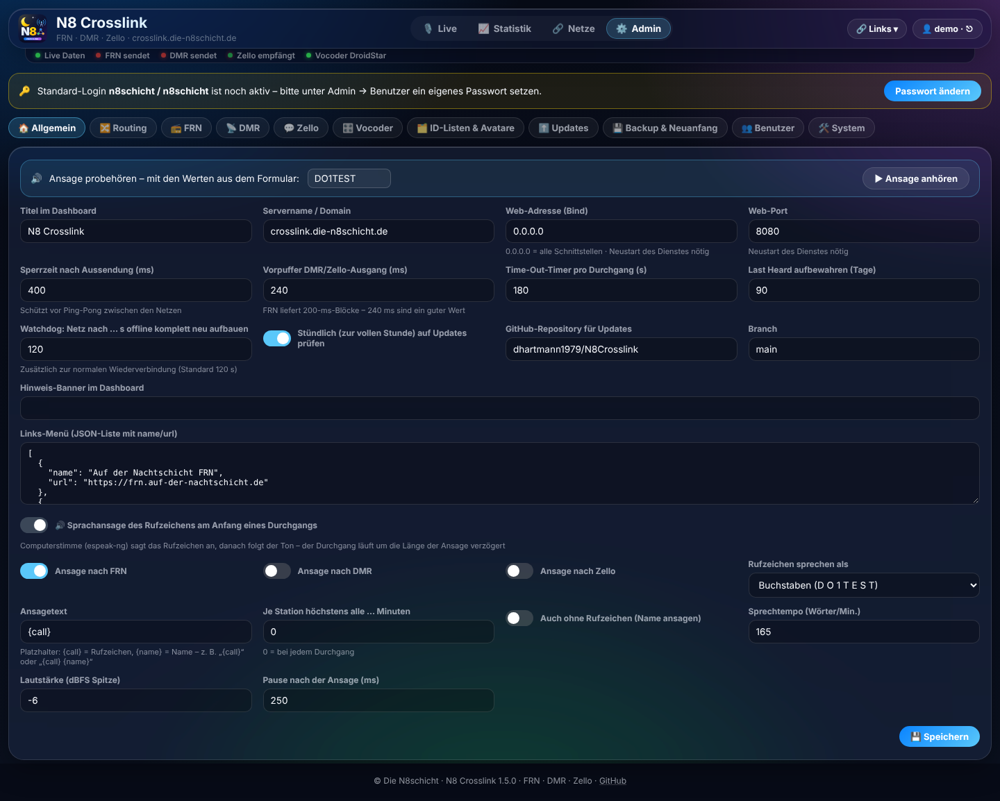
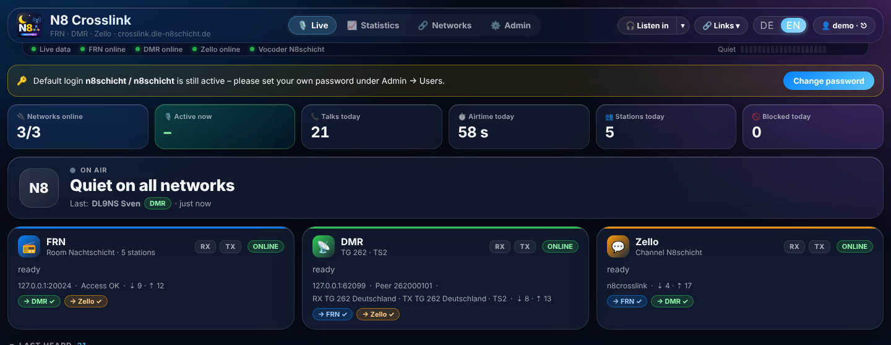
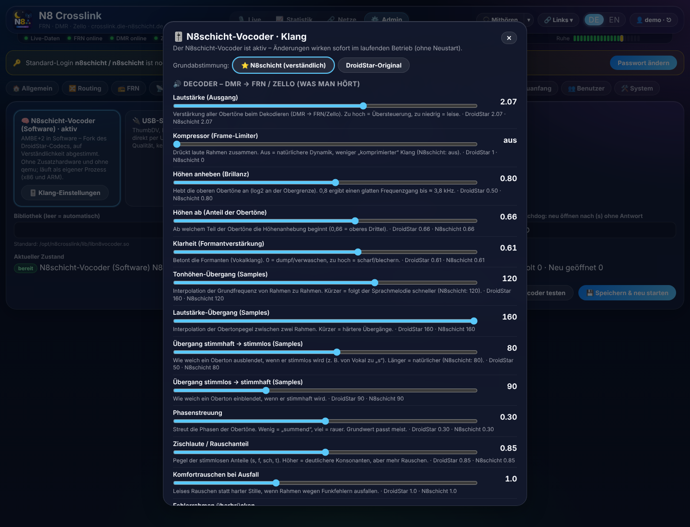
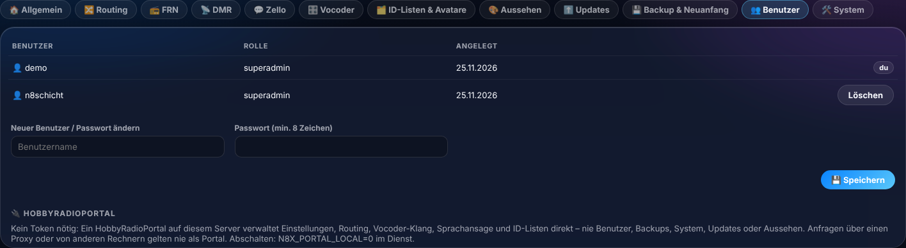

# Konfiguration / Adminportal

Anmelden über **🔐 Login** oben rechts – Standard **n8schicht / n8schicht** (bitte ändern, das Dashboard erinnert daran). Alle Werte liegen in SQLite (`/opt/n8crosslink/data/crosslink.db`); Passwörter werden nie im Klartext angezeigt (Feld leer lassen = unverändert).

## 🏠 Allgemein
| Feld | Bedeutung |
|---|---|
| Sperrzeit nach Aussendung | Nach dem Ende einer Durchsage nimmt die Bridge so lange nichts aus den Zielnetzen an (Ping-Pong-Schutz). Standard 600 ms |
| Vorpuffer DMR/Zello | Puffer vor dem Senden. FRN liefert 200-ms-Blöcke über TCP, daher 240 ms Standard. Hörbare Lücken → erhöhen |
| Time-Out-Timer | Maximale Dauer eines Durchgangs (Standard 180 s) |
| Hinweis-Banner / Links | erscheinen im Dashboard |
| Watchdog | Netz nach so vielen Sekunden offline komplett neu aufbauen (Standard 120 s) |
| Updateprüfung | stündlich zur vollen Stunde, Repository und Branch einstellbar |

Diese Werte wirken sofort; Web-Adresse und -Port erst nach *Dienst neu starten*.

### 🔊 Sprachansage des Rufzeichens (Standard: aus)
Am Anfang eines Durchgangs sagt eine Computerstimme (espeak-ng, offline, wird vom Installer mitinstalliert) das Rufzeichen der Station an; danach folgt der Ton. Das hören alle – egal mit welchem Programm sie zuhören.

| Feld | Bedeutung |
|---|---|
| Ansage nach FRN / DMR / Zello | in welche Netze angesagt wird (Standard nur FRN) |
| Rufzeichen sprechen als | Buchstaben („De O Eins Te E Es Te“) oder NATO-Alphabet („Delta, Oscar, Eins …“) |
| Ansagetext | `{call}` = Rufzeichen, `{name}` = Name, z. B. `{call} {name}` |
| Je Station höchstens alle … Minuten | 0 = bei jedem Durchgang; z. B. 10 = nur beim ersten Durchgang nach 10 Minuten Pause |
| Auch ohne Rufzeichen | Stationen ohne Rufzeichen (z. B. Zello-Namen) mit dem Namen ansagen |
| Tempo, Lautstärke, Pause | Feinabstimmung; mit **▶ Ansage anhören** sofort im Browser probehören |

Wichtig: Der ganze Durchgang läuft um die Länge der Ansage verzögert (Buchstaben bei 7 Zeichen ≈ 2 s, NATO länger). Die Ansage wird im 20-ms-Takt vor den Ton gesetzt; folgt gleich der nächste Durchgang, wird der Rest sofort ausgegeben. Ohne bekanntes Rufzeichen (und ohne „Auch ohne Rufzeichen“) gibt es keine Ansage.

## 🔀 Routing
Matrix mit allen sechs Richtungen. Wirkt sofort, ohne Neustart.

## 📻 FRN
Server, Backup-Server, Konto, Rufzeichen/Name (erscheint im FRN-Raum als „Rufzeichen, Name“), Client-Typ (0 = Crosslink, 1 = Gateway, 2 = PC Only), Band/Kanal, Raum. *Ende-Erkennung RX* ist die Zeit ohne Sprachpaket, nach der ein Durchgang als beendet gilt. 

### 💬 Sprechername als Textnachricht
Ist *Sprechername als FRN-Textnachricht* an, schickt die Bridge vor jedem Durchgang aus DMR/Zello eine Textnachricht wie „DO1TEST Tobias (DMR)“.

* *Textnachricht nur an diese Stationen (privat)* leer = **öffentlich an alle** im Raum (FRN-Befehl `TM:` mit leerer `<ID>`).
* Mit Rufzeichen (Komma-Liste, z. B. `DL1ABC, DB0XYZ`) geht die Nachricht **privat** nur an diese Stationen (`<ID>` = deren Client-ID aus der Raumliste). Bei allen anderen ploppt nichts auf. Einen stillen „Info“-Nachrichtentyp kennt das FRN-Protokoll nicht.

Operator (`<ON>`) und Beschreibung (`<DS>`) überträgt FRN nur bei der Anmeldung; ein Operator-Wechsel per Neuanmeldung (1.5.0) hat in der Praxis nicht funktioniert und ist ab 1.6.0 wieder entfernt.

### 📧 FRN-Passwort anfordern
Wer noch kein FRN-Konto hat: Rufzeichen, Name, E-Mail, Band/Kanal, Land und Ort („Ort - Ortsteil“) ausfüllen und **„📧 Passwort anfordern“** klicken. Die Werte aus dem Formular werden auch ohne Speichern genommen. Die Bridge registriert die Station beim **System Manager** (Standard `sysman.freeradionetwork.eu:10025`, einstellbar für eigene FRN-Netze), genauso wie das SvxLink-Skript `frn-register`. Ein Popup zeigt das Ergebnis:

| Popup | Bedeutung |
|---|---|
| ✅ Passwort angefordert | Registrierung angenommen – das Passwort kommt per E-Mail (auch Spam-Ordner prüfen), dann ins Feld „Passwort (FRN)“ eintragen und speichern |
| ⚠️ Bereits registriert | Rufzeichen/E-Mail ist schon vergeben – vorhandenes Passwort verwenden |
| ⚠️ Eingaben prüfen | z. B. ungültige E-Mail, Band/Kanal nicht im Format „PC Only“ / „Crosslink“ / „446.03125FM CTC131.8“, Ort ohne „ - “ – es wurde nichts gesendet |
| ⚠️ Keine Verbindung / Keine Antwort | System Manager nicht erreichbar |
| ⚠️ Abgelehnt | System Manager lehnt die Daten ab (Antwortcode wird angezeigt) |

Pro Minute ist eine Anforderung möglich.

## 📡 DMR
| Feld | Bedeutung |
|---|---|
| Peer-ID / Passwort | Zugang am HBlink4/FreeDMR |
| Peer-ID / Passwort bei HBlink4-FreeRadioID | Ist am Server der FreeRadioID-Secure-Login aktiv, macht die lokale Passphrase die Bridge zum **Gast**: Empfang geht, Senden nur in die Gast-Talkgroups. Für Senden in andere TGs das persönliche FreeRadioID-Passwort der Peer-ID verwenden oder das Muster der Bridge am Server von FreeRadioID ausnehmen (siehe [Fehlersuche](FEHLERSUCHE.md)) |
| Quell-ID | DMR-ID, mit der Durchsagen aus FRN/Zello gesendet werden |
| Rufzeichen → eigene DMR-ID | Wenn das Rufzeichen des Sprechers in der ID-Datenbank steht, wird dessen ID als Quelle benutzt (aus = immer Quell-ID) |
| Empfangs-/Sende-TG, Zeitschlitz | 0 als Empfangs-TG = alle Gruppenrufe auf dem Zeitschlitz |
| RPTO | Optionen beim Login, z. B. `TS2=262` |
| Talker Alias | Stationsname im Sprachrahmen (Embedded LC, max. 31 Zeichen 7-Bit) – Funkgeräte zeigen ihn an |
| DMRA-Pakete | Talker Alias zusätzlich als Netzpaket. **Für HBlink4 ausgeschaltet lassen** – HBlink4 beantwortet DMRA mit MSTNAK |

## 💬 Zello
**Private Key:** Liegt eine Datei `zello*.key`/`zello*.pem` im Programm-, Daten- oder Quellordner, übernimmt Installer/Update/Berechtigungsprüfung sie automatisch: sicher verschieben (nur root) → in SQLite übernehmen → per Fingerabdruck gegenprüfen → Datei mit `shred` löschen. Gelesen wird der Schlüssel nur noch aus der Datenbank (und er ist im verschlüsselten Backup). Von Hand: `sudo /opt/n8crosslink/install.sh --fix-perms`. Fingerabdruck anzeigen: `… cli zello-key-info`.

**Schritt-für-Schritt-Anleitung: [ZELLO.md](ZELLO.md).** Kurz: Server (`wss://zello.io/ws` bzw. `wss://zellowork.io/ws/NETZ`), Kanal, Konto, Authentifizierung: *Entwickler-Token* (30 Tage gültig, von developers.zello.com), *Issuer + Private Key* (die Bridge erzeugt selbst JWTs – für den Dauerbetrieb) oder *keine* (Zello Work). Text-Vorlage für den Sprechernamen mit `{name}`, `{callsign}`, `{source}`, `{detail}`.

## 🗂️ ID-Listen & Avatare
| Quelle | Verwendung |
|---|---|
| FreeRadioID `subscriber_ids.csv` (Ersatz `.json`, dann RadioID.net) | alle DMR-IDs → Rufzeichen + Vorname in Last Heard, On Air, Talker Alias |
| FreeRadioID `local_subscriber_ids.json` (Ersatz `.csv`) | bei FreeRadioID registrierte IDs → **FRID**-Kennzeichen, Avatare |
| FreeRadioID `dmr/user/?id=` | unbekannte ID wird live nachgeschlagen, der Name erscheint noch während der Durchsage |
| `n8schicht/talkgroup_ids.json` | Talkgroup-Namen (z. B. „TG 262 Deutschland“) |

Aktualisierung 1× täglich automatisch und per **„ID-Listen jetzt aktualisieren“**.

**Avatare** liegen in SQLite (192 px WebP) und werden 1× täglich oder per **„Avatare jetzt aktualisieren“** neu geladen:
* **DMR:** FreeRadioID-Profilbild (`idimg-<ID>.png`); der graue Platzhalter wird erkannt und nicht gespeichert.
* **FRN:** Rufzeichen → ID aus der Liste → FreeRadioID-Bild.
* **Zello:** Die Zello Channel API liefert keine Profilbilder. Daher: 1. eigenes Bild hochladen (pro Zello-Benutzer), 2. optionale URL-Vorlage mit `{username}`, 3. enthält der Zello-Name ein Rufzeichen (z. B. `dl1abc_hans`), dessen FreeRadioID-Bild.

## 💾 Backup & Neuanfang
Nur für Superadmins. Bietet ein verschlüsseltes Backup zum Download, die Wiederherstellung (vorher prüfen) und das Zurücksetzen in drei Stufen. Wichtig: Der Schlüssel des Backups ist das Superadmin-Passwort, siehe [BACKUP.md](BACKUP.md) und [DEINSTALLATION.md](DEINSTALLATION.md).

## 🎧 Mithören
Angemeldete Admins sehen oben im Menü (neben *Links*) den Knopf **„🎧 Mithören“**; der kleine Pfeil **▾** rechts daran öffnet die **Lautstärke** (0–200 %, wird im Browser gemerkt). Der Ton der gerade aktiven Durchsage kommt aus jedem Netz (FRN, DMR oder Zello) als 8-kHz-Audio über einen eigenen, per Login geschützten WebSocket. Ohne Anmeldung wird die Verbindung abgelehnt, beim Abmelden endet das Mithören.

## 🎨 Aussehen
Dieselbe Farbtechnik (**N8 Theme 2**) wie HBlink4-FreeRadioID, adn-frn-server und N8-HotSpot: sieben Farbprofile (N8 Night, Ocean, Aurora, Ember, Violet, Graphite, Daylight), jede Farbe einzeln (Akzent, Akzent 2, Hintergrund, drei Leuchtfarben, Text, Kartentönung), dazu Hintergrundleuchten, Kartenhelligkeit, Rundung und Glasunschärfe. Die ganze Seite zeigt Änderungen sofort; **💾 Aussehen speichern** übernimmt sie (gespeichert in der Datenbank, Abschnitt `general.theme`), **↺ N8-Standard** setzt zurück. Wer in einem anderen N8-Dashboard schon ein Farbschema hat, stellt hier dieselben Werte ein – dann sehen alle Seiten gleich aus.

## 🌐 Sprache
Oben rechts neben *Links* schaltet **DE | EN** die Oberfläche um – Standard ist Deutsch. Die Wahl gilt sofort und per Cookie für alle N8schicht-Seiten auf demselben Server. Mehr in [SICHERHEIT.md](SICHERHEIT.md#sprache-de--en).

## ⬆️ Updates
Kachel im N8-Kit-Stil: installiert, auf GitHub, zuletzt geprüft, automatische Prüfung, letztes Update (erfolgreich/zurückgenommen), Update-Dienst, Neuerungen, **↻ Jetzt prüfen**, **⬆️ Update jetzt installieren** und das Update-Protokoll. Ablauf und Rollback: [BETRIEB.md](BETRIEB.md#updates).

## 🎛️ Vocoder
Betriebsart (N8schicht-Vocoder, USB-Stick, AMBEserver, Test), Pegel und Watchdog. Beim N8schicht-Vocoder öffnet **🎚️ Klang-Einstellungen** auf der Karte ein Popup mit Reglern (wirken sofort), Grundabstimmung und Probehören – alle Regler erklärt in [VOCODER.md](VOCODER.md#-klang-einstellungen-popup).

## 🔌 Im HobbyRadioPortal verwalten (ohne Token)
Seit 1.8.0 lässt sich die Brücke auch im [HobbyRadioPortal](https://github.com/dhartmann1979/HobbyRadioPortal) einstellen
(*Admin → Dienste → 🔀 Crosslink & Vocoder*): Allgemein, Sprachansage (mit Probehören), Routing, FRN (mit *Passwort anfordern*), DMR,
Zello, Vocoder mit **Klang-Einstellungen** und Probehören, ID-Listen & Avatare, Bridge neu starten, Vocoder testen.

Seit 1.11.0 braucht das **keinen Token** mehr: Läuft das Portal auf **demselben Rechner**, verwaltet es die Brücke direkt. Im Portal
steht unter *Dienste → Crosslink → Verbindung & Anzeige* nur die Adresse (meist `http://127.0.0.1:8070/`). Unter **👥 Benutzer** steht
ein kurzer Hinweis.

Das Portal darf nur Einstellungen, Routing, Vocoder-Klang, Sprachansage, FRN-Passwort-Anforderung, ID-Listen, Ereignisse und den
Neustart der Brücke – **nie** Benutzer, Backup/Neuanfang, System (Dienste, Neustart des Servers), Updates, Aussehen, Export/Import.
Web-Adresse/-Port und die Update-Quelle sind gesperrt. Jede Änderung steht im Ereignisprotokoll als
`api:HobbyRadioPortal (<Portal-Benutzer>)`. Wann ein Aufruf als Portal gilt und wie man es abschaltet:
[SICHERHEIT.md](SICHERHEIT.md#hobbyradioportal-auf-diesem-rechner-ohne-token).

Für andere Programme beschreibt `GET /api/admin/settings` alle Einstellungen (Bereiche, Felder, Art, Grenzen, Hilfetexte; Passwörter
nie im Klartext), `PUT /api/admin/settings {"changes": {"frn.port": 10024, …}}` ändert sie mit Prüfung.

**Titel:** Untertitel, Fußzeile und Seitenbeschreibung nennen nur die **eingeschalteten** Netze (z. B. *FRN · DMR*); `/api/info`
liefert dazu `nets` und `nets_label`.

## 🔒 Domains & HTTPS

Eigene Domains für das Webinterface mit kostenlosem **Let's-Encrypt-Zertifikat** – ohne Konsole (ab 1.12.0).

1. Fehlen nginx und certbot, steht oben **📦 Benötigte Pakete installieren** – ein Klick installiert `nginx`, `certbot` und
   `python3-certbot-nginx` und schaltet die automatische Erneuerung (certbot-Timer) ein.
2. Unter **➕ Domain hinzufügen** die Domain (z. B. `crosslink.example.org`) und die **E-Mail für Let's Encrypt** eintragen →
   **🔒 Domain anlegen & Zertifikat holen**. nginx nimmt die Domain auf Port 80/443 an und leitet zu N8 Crosslink
   (`127.0.0.1:<Web-Port>`, mit WebSocket) weiter; certbot holt das Zertifikat und stellt http:// auf https:// um.
3. Die Liste zeigt je Domain, wohin der DNS-Eintrag zeigt, ob HTTPS aktiv ist, das Zertifikat (Aussteller, Ablaufdatum, Resttage –
   rot unter 14 Tagen) und die Knöpfe **🔄 Erneuern**, **🔒 Zertifikat holen** (falls es beim ersten Mal nicht geklappt hat) und **Entfernen**
   (Weiterleitung und Zertifikat).
4. **Test-Zertifikat** nutzt die Staging-Umgebung von Let's Encrypt – zum Ausprobieren, ohne in die Limits zu laufen (Browser warnen bei
   diesen Zertifikaten).
5. **🛡️ Nur noch über HTTPS:** stellt die Web-Adresse auf `127.0.0.1` – dann ist `http://IP:Port` von außen zu und das Webinterface nur
   noch über die Domain erreichbar (ein HobbyRadioPortal auf demselben Rechner erreicht es weiter). Der Dienst startet dafür neu.

Voraussetzungen und Hinweise:

* Die Domain zeigt per DNS (A/AAAA) auf diesen Server, **Port 80 und 443** sind aus dem Internet erreichbar (Let's Encrypt prüft über Port 80).
* Lauscht N8 Crosslink selbst auf Port 80 oder 443, warnt die Seite: zuerst unter *Allgemein → Web-Port* einen anderen Port (z. B. 8070) eintragen.
* Belegt ein anderes Programm Port 80, steht das als Hinweis da.
* Läuft auf dem Rechner das **HobbyRadioPortal** und steht N8 Crosslink dahinter, verwaltet das Portal Domain und Zertifikat
  (*Domains & Zertifikate* dort) – dann hier nichts anlegen.
* Die Seite des alten Installers (`/etc/nginx/sites-available/n8crosslink`) wird erkannt und lässt sich hier erneuern oder entfernen.
* Technisch: root-Helfer `/opt/n8crosslink/n8x-certs.sh` (`status`, `deps`, `add`, `renew`, `remove`) über sudo – er prüft Domain, E-Mail
  und Port selbst, schreibt nur `/etc/nginx/sites-available/n8crosslink-<domain>`, prüft mit `nginx -t` und stellt bei Fehlern den alten
  Stand wieder her. Siehe [SICHERHEIT.md](SICHERHEIT.md#reverse-proxy-davor-empfohlen).

## 👥 Benutzer · 🛠️ System
Benutzer anlegen/löschen/Passwort ändern. System: **Dienste** (N8 Crosslink, erkannte alte Dienste wie svxlink/mmdvm_bridge/Zello-Bridge) mit Start, Stopp, Neustart, Autostart an/aus; **Berechtigungen prüfen & korrigieren**; **Server neu starten** (falls bei der Installation erlaubt); Bridge neu starten (nur die Netze), Dienst neu starten, ID-Listen aktualisieren, Konfiguration exportieren/importieren (ohne Passwörter), Ereignisprotokoll. Siehe [BETRIEB.md](BETRIEB.md).
