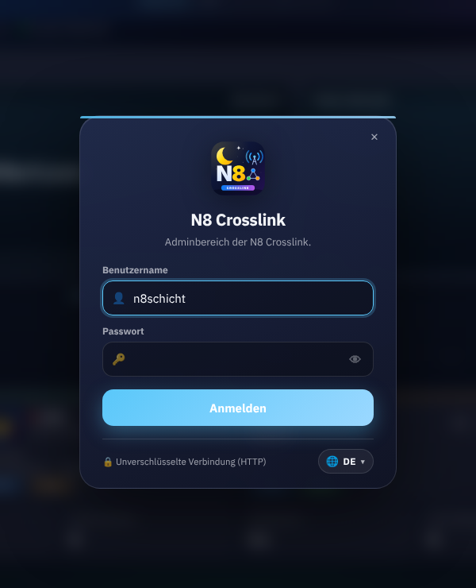
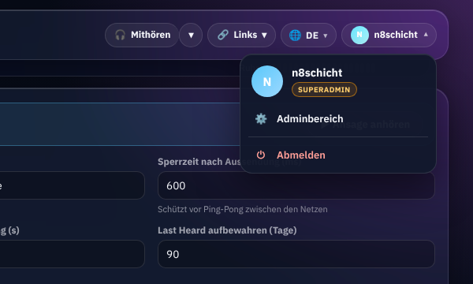
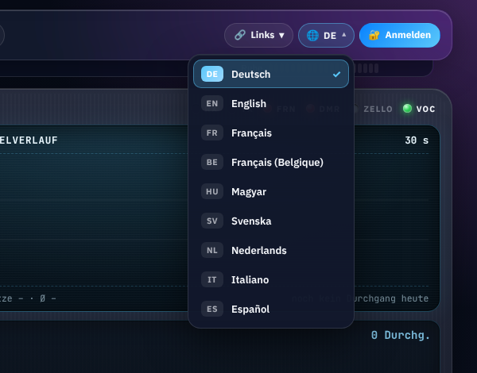
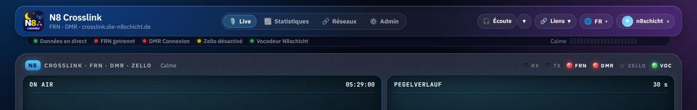

# 🔐 Sicherheit & N8 Kit

[← Übersicht](../README.md)

Diese Seite beschreibt, wie das Dashboard sich schützt, was du als Betreiber noch tun kannst (Reverse-Proxy), und das **N8 Kit** – die gemeinsamen Bausteine, die N8 Crosslink, HBlink4-FreeRadioID, adn-frn-server und N8-HotSpot gleich aussehen und sich gleich verhalten lassen.

## Was das Dashboard selbst tut

### Keine offene API-Beschreibung

FastAPI legt normalerweise unter `/docs`, `/redoc` und `/openapi.json` eine vollständige Beschreibung aller Routen an – mit allen Admin-Endpunkten und ihren Datenformaten. Das ist **abgeschaltet**; die drei Adressen antworten mit 404.

Zum Entwickeln lässt sie sich einschalten, nur mit einer Umgebungsvariablen beim Start:

```bash
N8_API_DOCS=1 /opt/n8crosslink/venv/bin/python -m n8crosslink
```

### Sicherheits-Header bei jeder Antwort

| Header | Wert | Wofür |
|---|---|---|
| `Content-Security-Policy` | `default-src 'self'`; Skripte, Styles, Schriften nur vom eigenen Server; Bilder auch `https:` (Kartenkacheln, Avatare); Verbindungen nur zum eigenen Server (`ws:`/`wss:` für Live-Daten); `object-src 'none'`, `base-uri 'self'`, `form-action 'self'`, `frame-ancestors 'self'` | fremde Skripte, Plugins, `<base>`-Tricks, fremde Formularziele und Einbetten in fremde Seiten werden vom Browser blockiert |
| `Strict-Transport-Security` | `max-age=31536000` | nur wenn die Seite über **HTTPS** kommt (direkt oder über einen Proxy mit `X-Forwarded-Proto: https`); verhindert SSL-Stripping |
| `Permissions-Policy` | Kamera, Mikrofon, Zahlung, USB, Seriell, Sensoren aus; Standort nur für die eigene Seite | Seiten können diese Geräte nicht ansprechen |
| `X-Content-Type-Options` | `nosniff` | Dateien werden nur als das ausgeführt, was sie sind |
| `X-Frame-Options` | `SAMEORIGIN` | kein Einbetten in fremde Seiten (Clickjacking) |
| `Referrer-Policy` | `same-origin` | Adressen des Dashboards gehen nicht an fremde Seiten |
| `Cross-Origin-Opener-Policy` / `-Resource-Policy` | `same-origin` / `same-site` | Fenster und Dateien sind von fremden Seiten getrennt |

Der Header `server: uvicorn` wird **nicht** mehr gesendet.

`'unsafe-inline'` ist für Skripte noch erlaubt, weil die Seiten Klick-Handler direkt im HTML haben. Deshalb ist das Escapen (nächster Abschnitt) die eigentliche Schutzschicht gegen XSS; die CSP sorgt dafür, dass ein Angreifer keine **fremden** Skripte nachladen und keine Daten an fremde Server schicken kann.

### Daten aus den Netzen

Rufzeichen, Namen und Orte kommen von FRN-Clients, aus DMR (ID-Liste, Talker Alias) und von Zello-Benutzern – fremde Eingaben. Jedes dieser Felder geht beim Anzeigen durch `esc()` bzw. wird als `textContent` gesetzt (Live, On Air, Last Heard, Netze, Statistik, Statusleiste, Ereignisse). Das Farbschema wird auf dem Server geprüft (nur bekannte Schlüssel, Farben als `#rrggbb`, Zahlen im erlaubten Bereich), bevor es in die Seite kommt.

### Anmeldung

Sitzungs-Cookie `HttpOnly`, `SameSite=Strict`, über HTTPS `Secure`. Jede schreibende Anfrage an `/api/` braucht den Header `X-N8` – eine fremde Webseite kann so nichts im Namen eines angemeldeten Admins auslösen (CSRF-Schutz). Sitzungen liegen in der Datenbank nur als SHA-256-Prüfsumme: wer eine Kopie der Datenbank hat, kann sich damit nicht anmelden (alte Sitzungen werden beim Start umgestellt).

<p align="center"> </p>

Das **Anmeldefenster** ist in allen N8-Systemen gleich: Logo und Titel des Systems, Benutzername und Passwort mit 👁 zum Anzeigen, Hinweis bei
eingeschalteter Feststelltaste, Schalter „Angemeldet bleiben“, Sprachmenü und ein Hinweis, ob die Verbindung verschlüsselt ist. Ein falsches
Passwort oder eine Sperre wird direkt im Fenster gemeldet. Angemeldet zeigt die Kopfleiste **Avatar + Name ▾** – das Menü darunter enthält
Rolle, Konto bzw. Passwort, den Adminbereich und **Abmelden**.


Solange der Standard-Login `n8schicht / n8schicht` gilt, sind alle Admin-Änderungen gesperrt – außer dem Ändern des Passworts unter *Admin → Benutzer & Zugang*. Mithören läuft über einen eigenen WebSocket, der nur angemeldete Admins annimmt.


### Schutz vor Flooding und Brute-Force (N8 Guard)

Seit dem Sicherheits-Update im November 2026 läuft in allen N8-Systemen derselbe Wächter **N8 Guard** vor dem Dashboard:

| Was | Grenze je IP-Adresse | Antwort bei Überschreitung |
|---|---|---|
| API-Aufrufe (`/api/…`) | 1200 pro Minute (kurze Spitzen erlaubt) | `429 Too Many Requests` mit `Retry-After` |
| Seitenaufrufe | 600 pro Minute | `429` |
| Anmelde-Versuche (POST an Login/Setup) | 30 pro Minute | `429` |
| WebSocket-Verbindungen | 60 neue pro Minute, höchstens 24 gleichzeitig | Verbindung wird abgelehnt |
| Größe einer Anfrage | 64 MB | `413 Payload Too Large` |

Dazu kommt die **Login-Sperre**: 5 Fehlversuche für denselben Benutzernamen oder 10 Fehlversuche von derselben IP innerhalb von
15 Minuten sperren für 15 Minuten (`429`, mit Hinweis in der Anmeldemaske). Eine erfolgreiche Anmeldung setzt den Zähler zurück.
Die Sperre gilt auch für Anmeldungen, deren Benutzername gar nicht existiert – von außen ist nicht zu erkennen, ob es ihn gibt.

Die IP-Adresse kommt immer aus der Verbindung selbst. Den Header `X-Forwarded-For` nimmt das Dashboard **nur vom eigenen Rechner**
(`127.0.0.1`, also vom Reverse-Proxy) an – ein Angreifer kann sich damit keine neue Adresse ausdenken, um die Sperren zu umgehen.
Statische Dateien (`/static/…`) und die Let's-Encrypt-Prüfung zählen nicht mit.

## Ohne Anmeldung keine IPs und Ports (ab 1.16.0)

Die Live-Seite ist öffentlich – Serveradressen, IP-Adressen und Ports aber nicht. Für Besucher ohne Anmeldung entfernt N8 Crosslink sie aus
allem, was die Seite lädt (`/api/state`, `/api/events`, `/api/lastheard`, `/api/info`, die Startseite und die Live-Verbindung `/ws`):

* Felder mit Adressen fallen ganz weg (`server`, `host`, `ambeserver_host`, `usb_device`, `web_port` …) – die Netzkarten und *Netze* zeigen
  dann z. B. bei FRN/DMR/Zello keine Server-Zeile.
* In Texten (Status, Ereignisse wie „DMR verbunden mit 192.168.79.204 …“, „Verbindung zu frn.example.org:10024 fehlgeschlagen“) werden
  IPv4/IPv6 durch `•••` ersetzt, Ports entfernt bzw. maskiert (`host:port` → `host`, `Port 8080` → `Port •••`, `web_port=8070` →
  `web_port=•••`, `ws://127.0.0.1:8799/ws` → `ws://•••`). Hostnamen ohne Port und normale Links bleiben lesbar.
* Auch der Servername im Kopf wird so bereinigt, falls dort eine IP oder ein Port steht.

Angemeldete Admins sehen alles; nach dem An- oder Abmelden baut die Seite die Live-Verbindung neu auf.

## Reverse-Proxy davor (empfohlen)

N8 Crosslink bringt kein eigenes HTTPS mit. Soll das Dashboard aus dem Internet erreichbar sein, gehört ein **Reverse-Proxy** mit HTTPS davor –
am einfachsten über **⚙️ Admin → 🔒 Domains & HTTPS** (nginx + Let's Encrypt per Klick, siehe [KONFIGURATION.md](KONFIGURATION.md#-domains--https)).
Das Webinterface ruft dafür nur den root-Helfer `/opt/n8crosslink/n8x-certs.sh` per sudo auf (eine Zeile in `/etc/sudoers.d/n8crosslink`);
er nimmt nur `status`, `deps`, `add`, `ports`, `renew`, `remove` an, prüft Domain (Kleinbuchstaben, gültige Labels), E-Mail und alle Ports
(1–65535, Web-, HTTP- und HTTPS-Port verschieden), löscht nur Dateien mit geprüftem Namen `n8crosslink*` unter `/etc/nginx`, schreibt nur
`/etc/nginx/sites-available/n8crosslink-<domain>` und übernimmt nichts ohne erfolgreiches `nginx -t`. Die Domain-Verwaltung können nur
angemeldete Admins bedienen. Von Hand geht es so: Zertifikate, Header und Protokolle an einer Stelle. Das Dashboard lauscht dann nur lokal (Admin → Allgemein → Web-Adresse `127.0.0.1`, Port z. B. 8080; Neustart des Dienstes). Die Weiterleitungs-Header (`X-Forwarded-Proto`) wertet N8 Crosslink aus.

**Caddy** (holt das Zertifikat selbst):

```caddy
crosslink.example.org {
    encode zstd gzip
    header {
        Strict-Transport-Security "max-age=31536000"
        -Server
    }
    reverse_proxy 127.0.0.1:8080
}
```

**nginx**:

```nginx
server {
    listen 443 ssl http2;
    server_name crosslink.example.org;
    ssl_certificate     /etc/letsencrypt/live/crosslink.example.org/fullchain.pem;
    ssl_certificate_key /etc/letsencrypt/live/crosslink.example.org/privkey.pem;
    server_tokens off;
    add_header Strict-Transport-Security "max-age=31536000" always;

    location / {
        proxy_pass http://127.0.0.1:8080;
        proxy_http_version 1.1;
        proxy_set_header Upgrade $http_upgrade;          # Live-Daten (WebSocket)
        proxy_set_header Connection "upgrade";
        proxy_set_header Host $host;
        proxy_set_header X-Forwarded-For $proxy_add_x_forwarded_for;
        proxy_set_header X-Forwarded-Proto $scheme;      # damit das Dashboard HSTS setzt
        proxy_read_timeout 1h;
    }
}
server { listen 80; server_name crosslink.example.org; return 301 https://$host$request_uri; }
```

Die übrigen Sicherheits-Header setzt das Dashboard selbst; der Proxy muss sie nur durchreichen (beide Beispiele tun das). FRN (TCP 10024), DMR (UDP) und Zello (WebSocket nach außen) laufen **nicht** über den Proxy. Der Proxy muss WebSockets durchreichen (Live-Daten und Mithören) – beide Beispiele tun das.

## N8 Kit

Gemeinsame Bausteine für **HBlink4-FreeRadioID, adn-frn-server, N8-HotSpot und N8 Crosslink**. Die Dateien sind in allen vier Repositories **identisch**; wer eine ändert, kopiert sie in die anderen.

| Datei | Inhalt |
|---|---|
| `n8crosslink/web/static/n8-kit.js` | Sprache DE/EN, Übersetzung, Sprachumschalter, Update-Hinweis, Updates-Kachel, Update-Fortschritt |
| `n8crosslink/web/static/n8-kit.css` | Aussehen dieser Bausteine, auf Basis der N8-Theme-2-Farben |
| `n8crosslink/web/static/n8-theme.js`, `n8-theme.css`, `n8-light.css` | N8 Theme 2: Farbprofile, Farbeditor, helles Profil Daylight |
| `n8crosslink/web/n8_security.py` | Sicherheits-Header, API-Doku aus, kein `server`-Header |
| `update.sh` | Prüfung nach dem Update und Rollback (bei N8 Crosslink schon seit 1.5.1; schreibt jetzt `data/update.result` im gemeinsamen Format) |
| `n8crosslink/web/static/i18n-crosslink.js` | die englischen Texte dieser Oberfläche (eigene Datei je Projekt; hier ist Deutsch die Grundsprache) |

### Sprache – neun Sprachen

<p align="center"></p>
<p align="center"></p>

- Das Sprachmenü **🌐 DE ▾** steht in der Kopfleiste neben 🔗 Links und der Anmeldung, auch ohne Anmeldung – und unten im Anmeldefenster.
- **Neun Sprachen:** Deutsch, English, Français, Français (Belgique), Magyar, Svenska, Nederlands, Italiano, Español. Übersetzt mit den
  Fachbegriffen des Funkbetriebs (Rufzeichen → *indicatif / hívójel / anropssignal / roepnaam / nominativo / indicativo*, Talkgroup, Time Slot,
  Color Code bleiben wie im DMR-Alltag).
- **Beim ersten Besuch gilt die Sprache des Browsers**, wenn es eine der neun ist, sonst Deutsch. Die Wahl gilt **sofort**, ohne Neuladen, und
  wird im Cookie `n8_lang` gespeichert. Cookies gelten für alle Ports eines Servers – wer auf diesem Server Französisch wählt, sieht auch die anderen
  N8schicht-Oberflächen auf diesem Server auf Französisch.
- Datum, Uhrzeit und Zahlen folgen der Sprache (z. B. `26/11/2026` auf Französisch, `2026. 11. 26.` auf Ungarisch).
- Für einen Link in einer bestimmten Sprache: `?lang=fr` (bzw. `de`, `en`, `fr-BE`, `hu`, `sv`, `nl`, `it`, `es`) an die Adresse hängen.
- Übersetzt wird die fertige Seite: Texte und die Attribute `title`, `placeholder`, `aria-label`, `alt`. Neue Inhalte (Live-Daten, Fenster)
  werden übersetzt, sobald sie erscheinen; auch Rückfragen (`confirm`) folgen der Sprache. Rufzeichen, Namen, Raum-/Kanal-/TG-Namen und Code bleiben, wie sie sind.
- **Technik:** Deutsch und Englisch sind immer geladen. Jede weitere Sprache liegt in einer eigenen Datei `n8-i18n-<sprache>.js` (rund 80 KB)
  und wird nur geladen, wenn sie gewählt ist – beim ersten Aufruf noch vor dem Anzeigen der Seite, damit nichts auf Deutsch aufblitzt.
  Die weiteren Sprachen sind nach dem englischen Text geordnet; ein deutscher Text wird erst ins Englische und dann in die Zielsprache übersetzt.
  Fehlt eine Übersetzung, erscheint der englische Text (Français (Belgique) nutzt zuerst die belgischen Abweichungen, dann Französisch).
- Fehlt ein deutsches oder englisches Wort: in `n8crosslink/web/static/i18n-crosslink.js` eine Zeile 'Deutscher Text': 'English text', – ohne führende Emojis und ohne Satzzeichen am Ende,
  Zahlen über die `rules` am Ende der Datei.

### Updates – überall gleich

| | |
|---|---|
| Prüfen | jede volle Stunde, auch ohne Anmeldung; installiert wird nur auf Knopfdruck |
| Hinweis | unter der Statusleiste, nur für Admins: *Update verfügbar: alt → neu* · Was ist neu? · Jetzt aktualisieren · Details · Später (ein Tag) |
| Installieren | Fenster mit Neuerungen, dann drei Schritte mit Fortschritt; die Seite lädt danach neu |
| Prüfung danach | die neue Version ruft ihre eigene Weboberfläche auf |
| Rollback | `update.sh` prüft die Weboberfläche per HTTP und stellt sonst die vorige Version wieder her |
| Ergebnis | *Letztes Update* in Admin → Updates: erfolgreich oder zurückgenommen, mit Zeit |

---

Weiter: [Betrieb](BETRIEB.md) · [Fehlersuche](FEHLERSUCHE.md)
