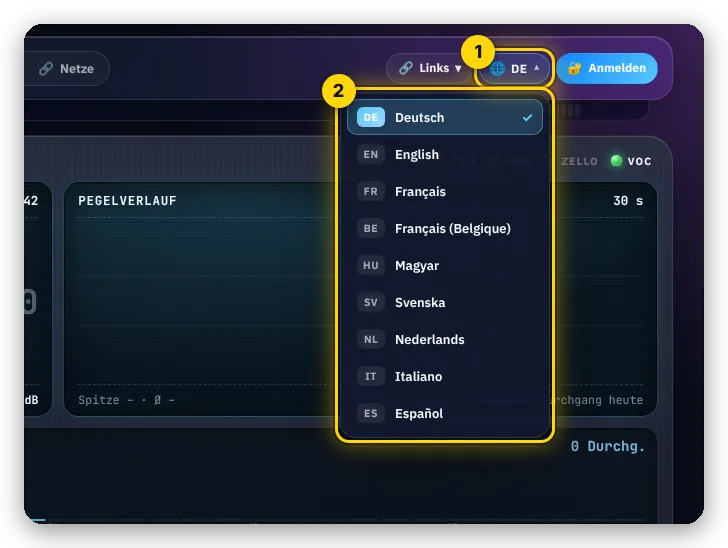

# 📘 N8 Crosslink – Anleitung · Guide

Schritt-für-Schritt-Anleitung mit Bildern in neun Sprachen · Step-by-step guide with pictures in nine languages.

| | |
|---|---|
| 🇩🇪 | [**Deutsch** – N8 Crosslink – Schritt für Schritt](de/README.md) |
| 🇬🇧 | [**English** – N8 Crosslink – Step by step](en/README.md) |
| 🇫🇷 | [**Français** – N8 Crosslink – Pas à pas](fr/README.md) |
| 🇧🇪 | [**Français (Belgique)** – N8 Crosslink – Pas à pas](fr-BE/README.md) |
| 🇭🇺 | [**Magyar** – N8 Crosslink – Lépésről lépésre](hu/README.md) |
| 🇸🇪 | [**Svenska** – N8 Crosslink – Steg för steg](sv/README.md) |
| 🇳🇱 | [**Nederlands** – N8 Crosslink – Stap voor stap](nl/README.md) |
| 🇮🇹 | [**Italiano** – N8 Crosslink – Passo dopo passo](it/README.md) |
| 🇪🇸 | [**Español** – N8 Crosslink – Paso a paso](es/README.md) |

