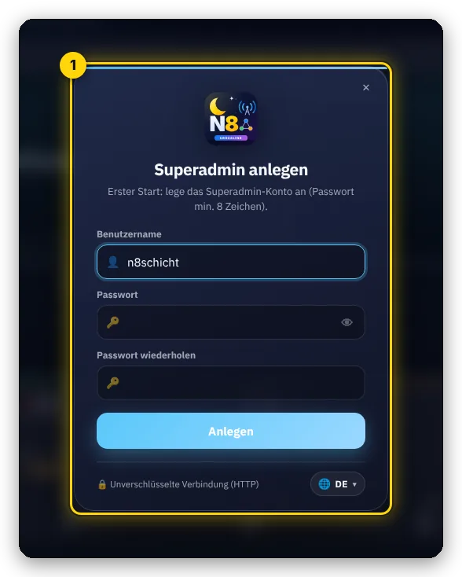
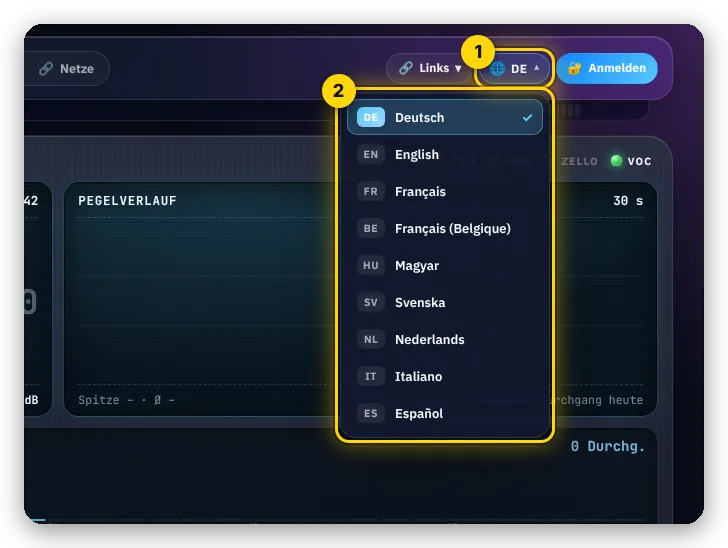
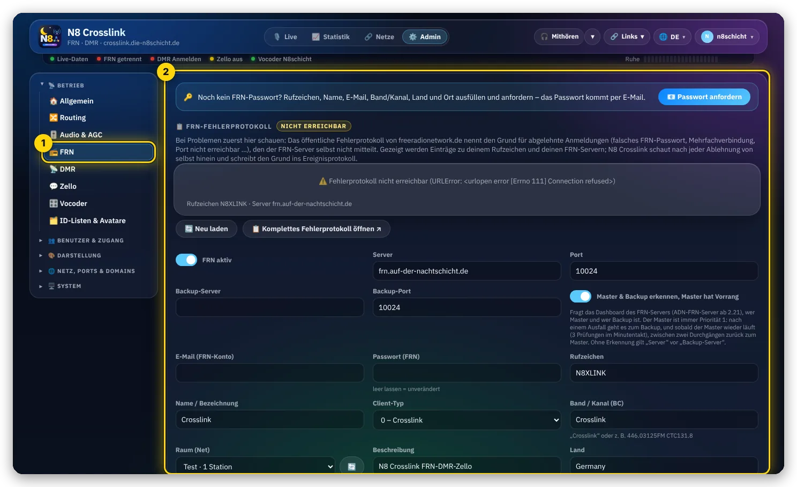
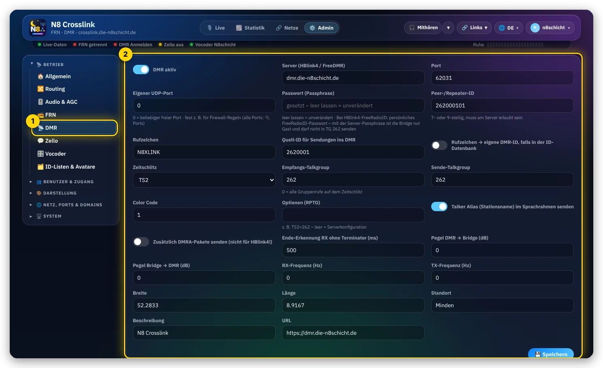
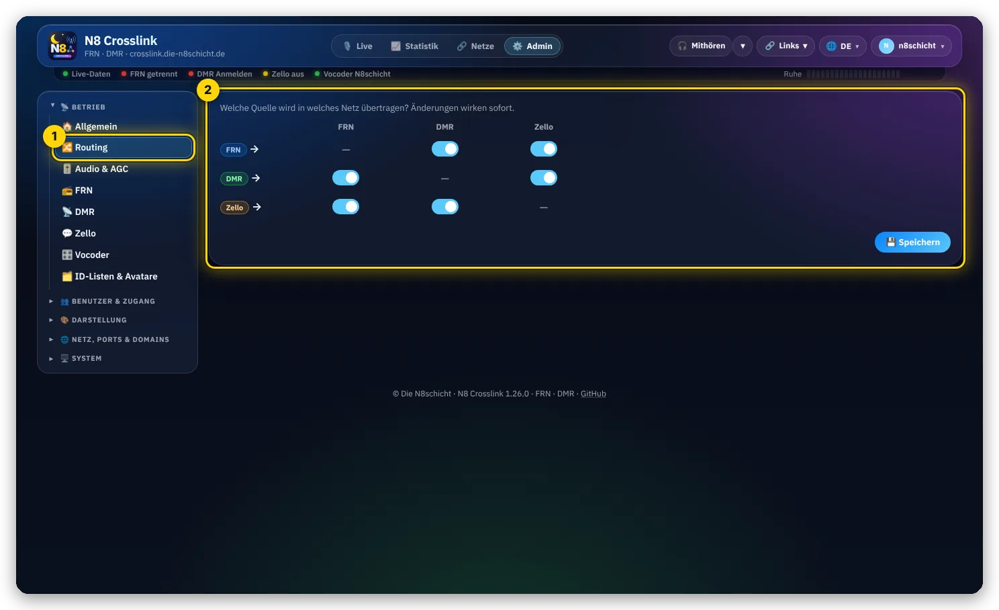
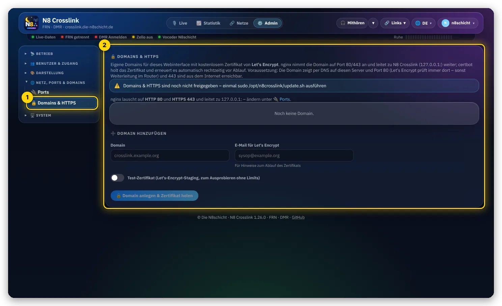
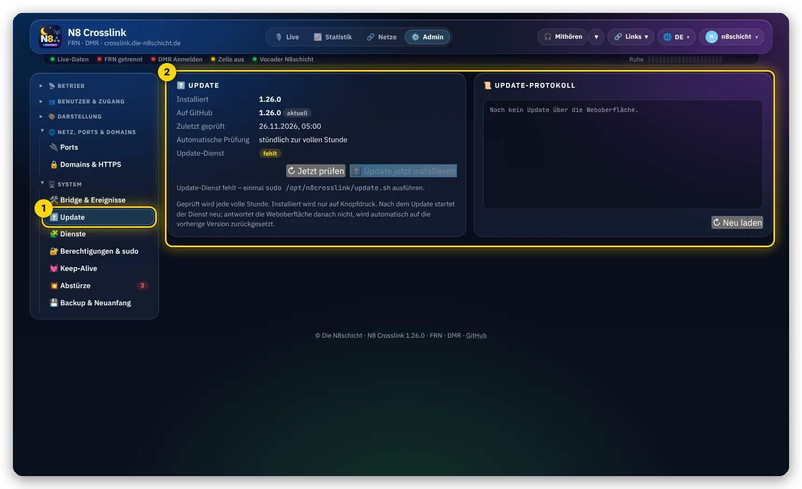
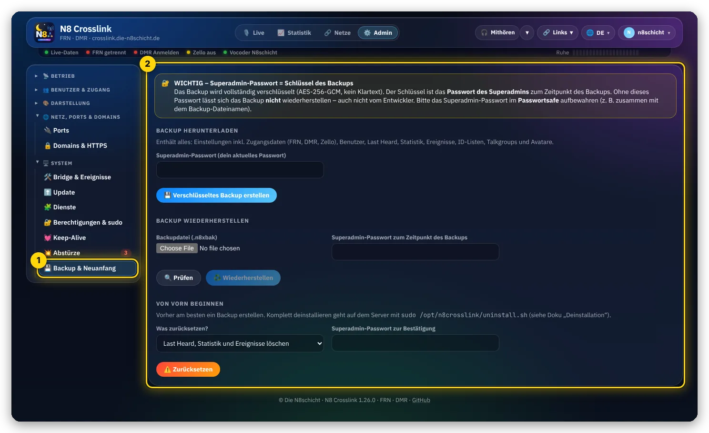

# 📘 N8 Crosslink – Schritt für Schritt

<sub>Sprache: **🇩🇪 Deutsch** · [🇬🇧 English](../en/README.md) · [🇫🇷 Français](../fr/README.md) · [🇧🇪 Français (Belgique)](../fr-BE/README.md) · [🇭🇺 Magyar](../hu/README.md) · [🇸🇪 Svenska](../sv/README.md) · [🇳🇱 Nederlands](../nl/README.md) · [🇮🇹 Italiano](../it/README.md) · [🇪🇸 Español](../es/README.md)</sub>

N8 Crosslink verbindet FRN, DMR und Zello zu einem gemeinsamen Funknetz. Diese Anleitung führt durch die ersten Schritte.

> 💡 Die gelben Ziffern im Bild gehören zu den Ziffern im Text.

## Inhalt

1. [Installieren](#1-installieren)
2. [Superadmin anlegen](#2-superadmin-anlegen)
3. [Sprache wählen](#3-sprache-wählen)
4. [FRN verbinden](#4-frn-verbinden)
5. [DMR verbinden](#5-dmr-verbinden)
6. [Routing festlegen](#6-routing-festlegen)
7. [Eigene Domain mit HTTPS](#7-eigene-domain-mit-https)
8. [Aktualisieren](#8-aktualisieren)
9. [Sichern und neu anfangen](#9-sichern-und-neu-anfangen)

## 1. Installieren

Auf einem Debian- oder Ubuntu-Rechner (auch Raspberry Pi) mit sudo-Rechten:

```bash
git clone https://github.com/dhartmann1979/N8Crosslink.git
cd N8Crosslink
sudo ./install.sh
```

Der Installer richtet Programm, Dienst, Vocoder und Rechte unter `/opt/n8crosslink` ein. Danach ist die Oberfläche unter `http://<rechner>:8080` erreichbar.

## 2. Superadmin anlegen

<p align="center"></p>

Beim ersten Aufruf erscheint **Superadmin anlegen** ①: Benutzername und ein Passwort mit mindestens 8 Zeichen, dann wiederholen. Dieses Konto darf alles, auch Sicherungen wiederherstellen. Später meldest du dich im selben Fenster an.

## 3. Sprache wählen

<p align="center"></p>

Oben rechts öffnet **🌐 DE ▾** ① das Sprachmenü ② mit neun Sprachen. Die Wahl gilt sofort und für alle N8-Oberflächen auf diesem Server. Beim ersten Besuch gilt die Sprache des Browsers.

## 4. FRN verbinden

<p align="center"></p>

Im Adminbereich unter **📡 Betrieb → 📻 FRN** ① trägst du Server, Port, E-Mail und FRN-Passwort ein ②. Den **Raum** wählst du aus der Liste, die direkt vom FRN-Server gelesen wird. Noch kein FRN-Passwort? Es lässt sich hier beim SystemManager anfordern.

## 5. DMR verbinden

<p align="center"></p>

Unter **📡 DMR** ① stehen DMR-Server, Peer-ID, Passwort und Talkgroups ②. Bei HBlink4-FreeRadioID ist das Passwort dein persönliches FreeRadioID-Passwort – mit der Server-Passphrase ist die Brücke nur Gast und darf nicht in alle Talkgroups senden.

## 6. Routing festlegen

<p align="center"></p>

Unter **🔀 Routing** ① legst du fest, welche Quelle in welches Netz geht ②, z. B. FRN → DMR und DMR → FRN. Eine Sperrzeit nach dem Senden verhindert Ping-Pong zwischen den Netzen. Änderungen gelten sofort.

## 7. Eigene Domain mit HTTPS

<p align="center"></p>

Unter **🌐 Netz, Ports & Domains → 🔒 Domains & HTTPS** ① trägst du eine Domain ein, die per DNS auf den Server zeigt, dazu eine E-Mail-Adresse für Let’s Encrypt ②. Das Zertifikat wird geholt und automatisch erneuert. Ports 80 und 443 müssen aus dem Internet erreichbar sein.

## 8. Aktualisieren

<p align="center"></p>

Unter **🖥️ System → ⬆️ Update** ① siehst du die installierte Version und ob GitHub eine neuere hat ②. **⬆️ Update jetzt installieren** lädt sie, prüft danach die Weboberfläche und stellt bei einem Fehler automatisch die vorherige Version wieder her. Ein Passwort ist dafür nicht nötig.

## 9. Sichern und neu anfangen

<p align="center"></p>

Unter **🖥️ System → 💾 Backup & Neuanfang** ① erstellst du eine verschlüsselte Sicherung ② – der Schlüssel ist das Superadmin-Passwort zum Zeitpunkt der Sicherung. Hier lassen sich auch Statistik oder alle Einstellungen zurücksetzen.

---

📖 Ausführliche Beschreibung (Deutsch): [docs/INSTALLATION.md](../../../docs/INSTALLATION.md)
