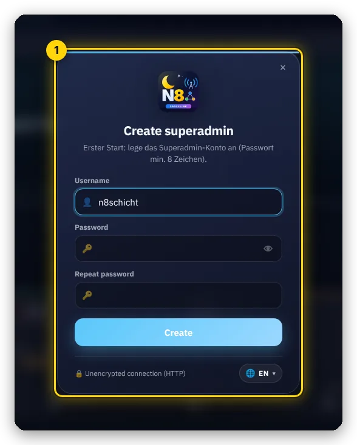
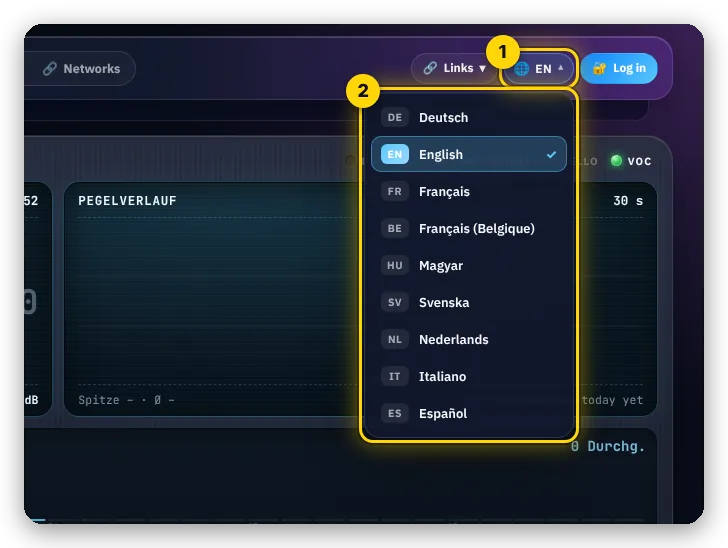
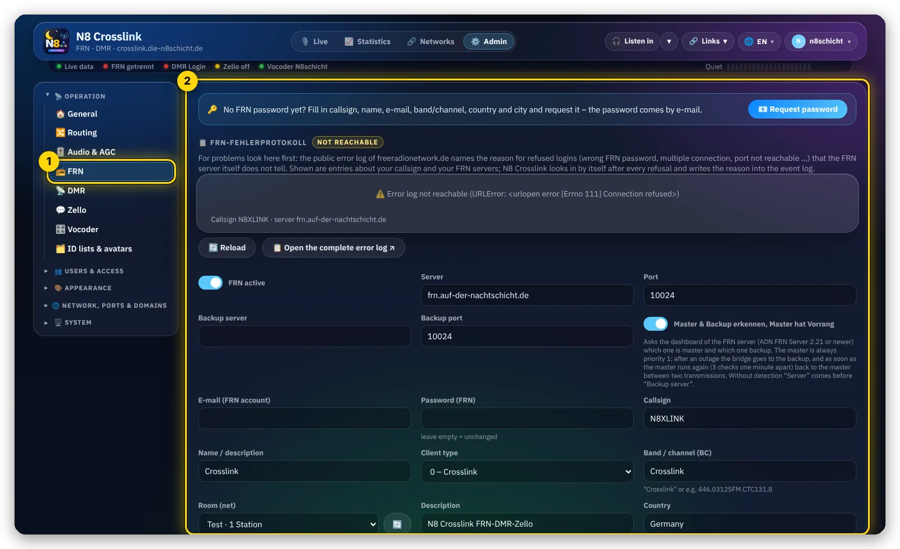
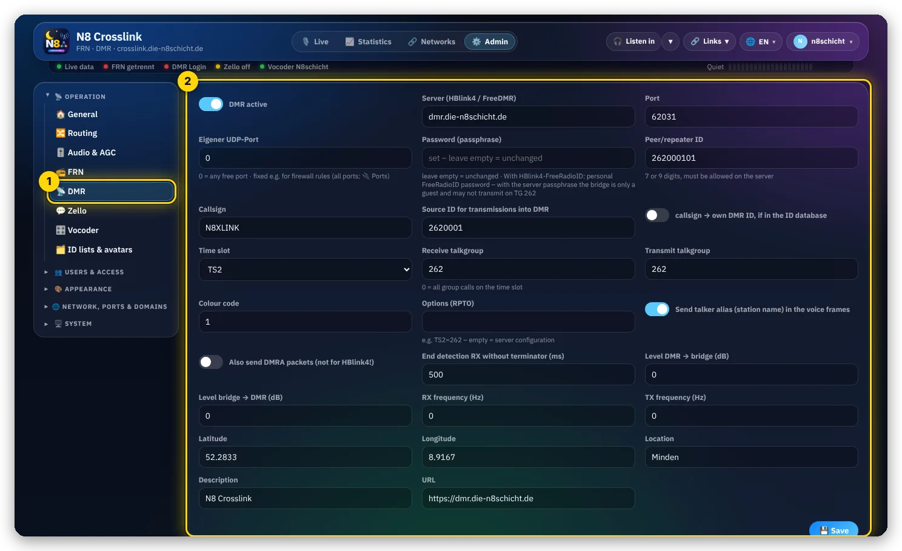
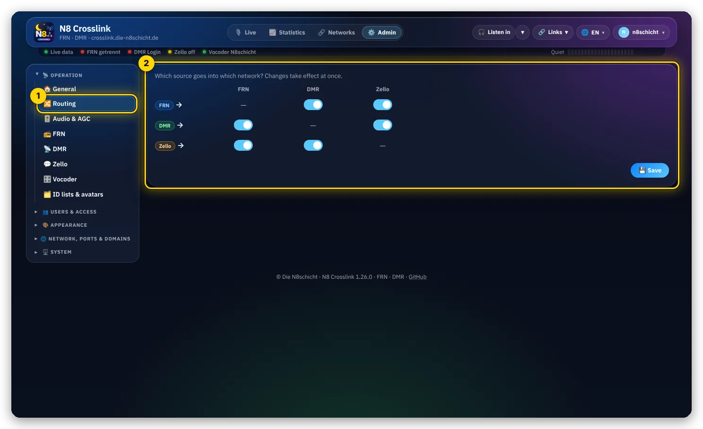
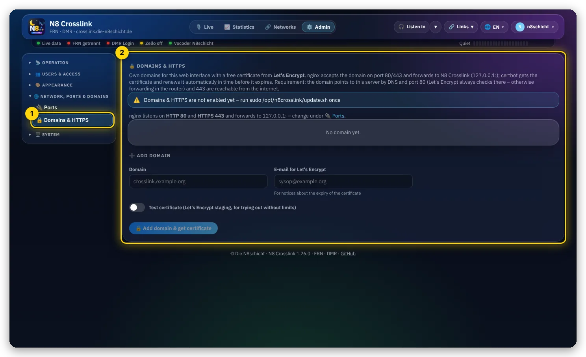
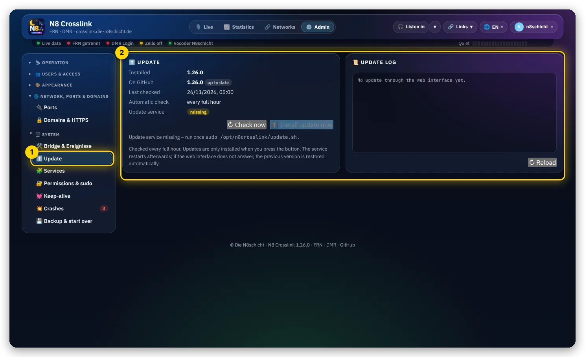
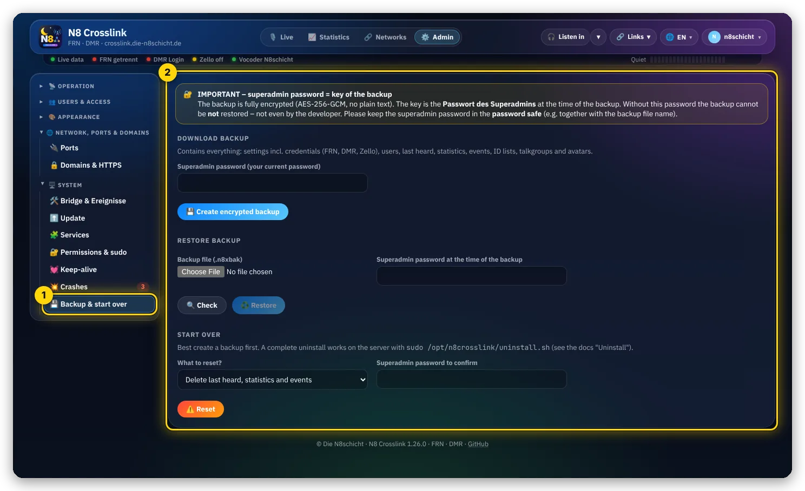

# 📘 N8 Crosslink – Step by step

<sub>Language: [🇩🇪 Deutsch](../de/README.md) · **🇬🇧 English** · [🇫🇷 Français](../fr/README.md) · [🇧🇪 Français (Belgique)](../fr-BE/README.md) · [🇭🇺 Magyar](../hu/README.md) · [🇸🇪 Svenska](../sv/README.md) · [🇳🇱 Nederlands](../nl/README.md) · [🇮🇹 Italiano](../it/README.md) · [🇪🇸 Español](../es/README.md)</sub>

N8 Crosslink connects FRN, DMR and Zello into one common radio network. This guide takes you through the first steps.

> 💡 The yellow numbers in the pictures belong to the numbers in the text.

## Contents

1. [Install](#1-install)
2. [Create the superadmin](#2-create-the-superadmin)
3. [Choose the language](#3-choose-the-language)
4. [Connect FRN](#4-connect-frn)
5. [Connect DMR](#5-connect-dmr)
6. [Set the routing](#6-set-the-routing)
7. [Own domain with HTTPS](#7-own-domain-with-https)
8. [Update](#8-update)
9. [Back up and start over](#9-back-up-and-start-over)

## 1. Install

On a Debian or Ubuntu computer (also Raspberry Pi) with sudo rights:

```bash
git clone https://github.com/dhartmann1979/N8Crosslink.git
cd N8Crosslink
sudo ./install.sh
```

The installer sets up program, service, vocoder and permissions under `/opt/n8crosslink`. Afterwards the interface is at `http://<computer>:8080`.

## 2. Create the superadmin

<p align="center"></p>

On the first visit **Create superadmin** ① appears: username and a password of at least 8 characters, then repeat it. This account may do everything, including restoring backups. Later you log in in the same window.

## 3. Choose the language

<p align="center"></p>

At the top right, **🌐 EN ▾** ① opens the language menu ② with nine languages. The choice applies at once and to all N8 interfaces on this server. On the first visit the language of the browser is used.

## 4. Connect FRN

<p align="center"></p>

In the admin area under **📡 Operation → 📻 FRN** ① enter server, port, e-mail and FRN password ②. Choose the **room** from the list that is read directly from the FRN server. No FRN password yet? It can be requested from the SystemManager here.

## 5. Connect DMR

<p align="center"></p>

Under **📡 DMR** ① you find DMR server, peer ID, password and talkgroups ②. With HBlink4-FreeRadioID the password is your personal FreeRadioID password – with the server passphrase the bridge is only a guest and may not transmit on all talkgroups.

## 6. Set the routing

<p align="center"></p>

Under **🔀 Routing** ① decide which source goes into which network ②, e.g. FRN → DMR and DMR → FRN. A lock time after transmitting prevents ping-pong between the networks. Changes apply at once.

## 7. Own domain with HTTPS

<p align="center"></p>

Under **🌐 Network, ports & domains → 🔒 Domains & HTTPS** ① enter a domain that points to the server by DNS, plus an e-mail address for Let’s Encrypt ②. The certificate is fetched and renewed automatically. Ports 80 and 443 must be reachable from the internet.

## 8. Update

<p align="center"></p>

Under **🖥️ System → ⬆️ Update** ① you see the installed version and whether GitHub has a newer one ②. **⬆️ Install update now** downloads it, then checks the web interface and restores the previous version automatically if something goes wrong. No password is needed for this.

## 9. Back up and start over

<p align="center"></p>

Under **🖥️ System → 💾 Backup & start over** ① create an encrypted backup ② – the key is the superadmin password at the time of the backup. Statistics or all settings can also be reset here.

---

📖 Detailed description (German): [docs/INSTALLATION.md](../../../docs/INSTALLATION.md)
