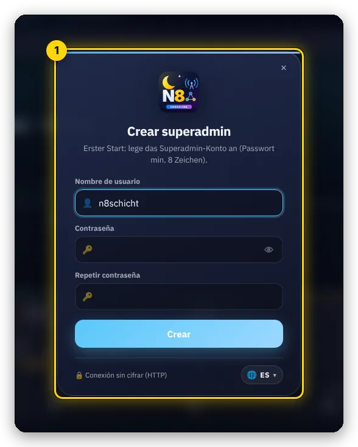
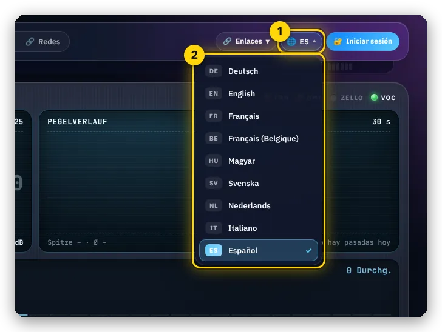
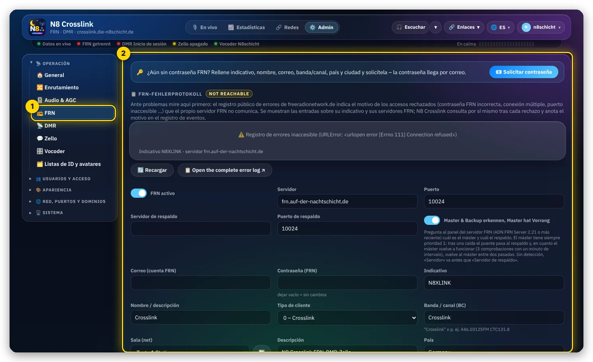
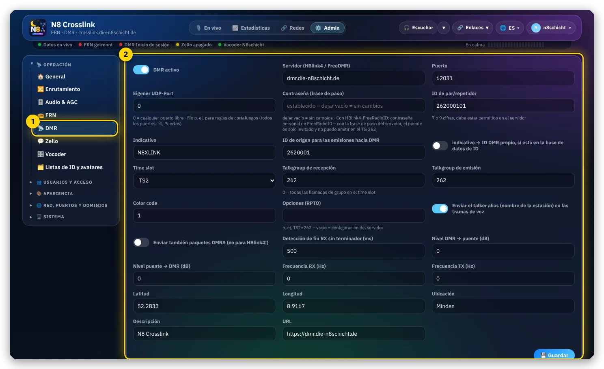
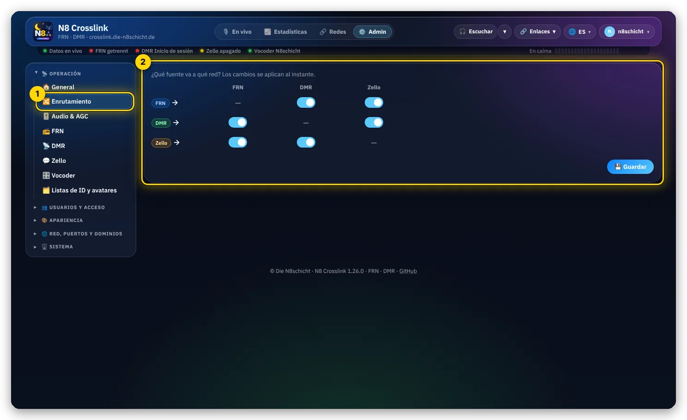
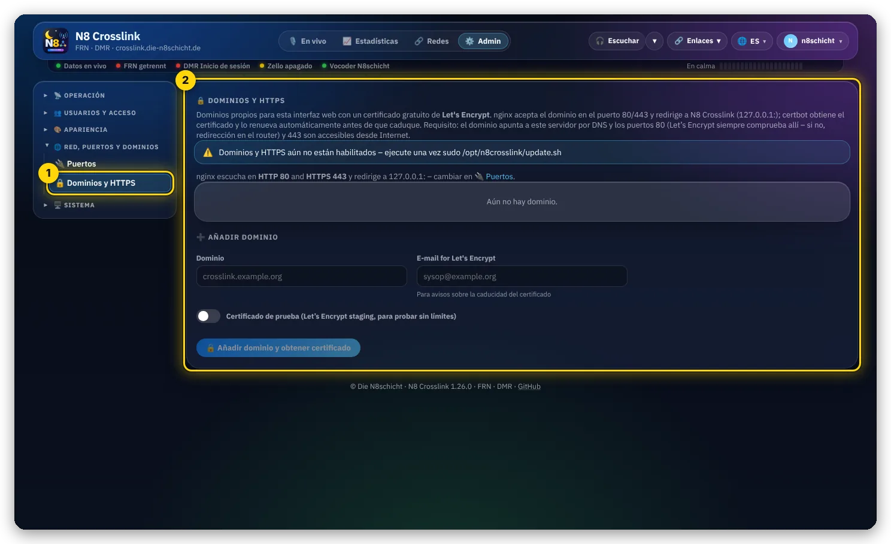
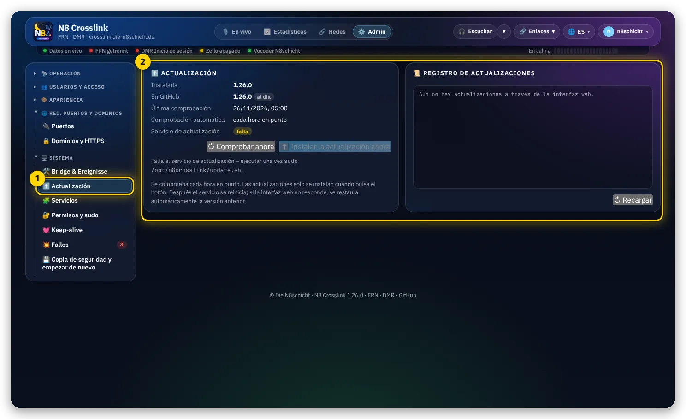
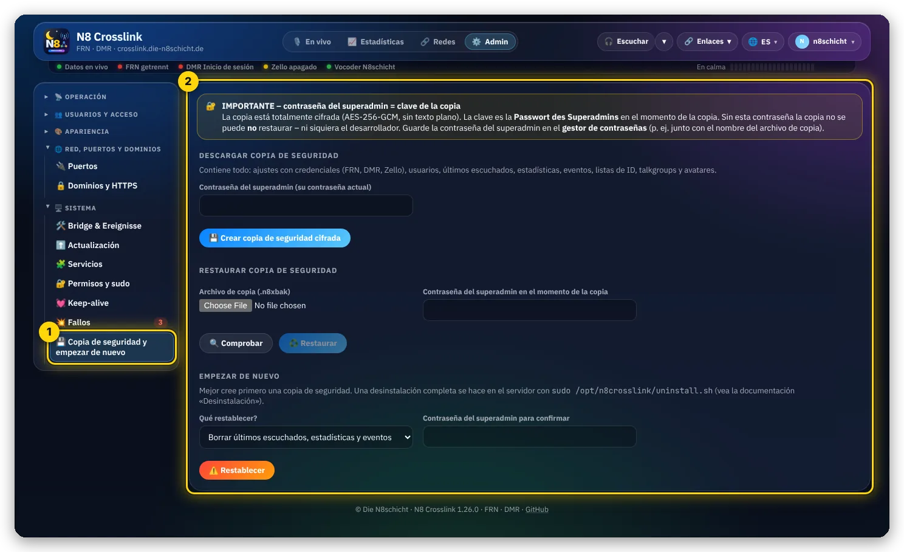

# 📘 N8 Crosslink – Paso a paso

<sub>Idioma: [🇩🇪 Deutsch](../de/README.md) · [🇬🇧 English](../en/README.md) · [🇫🇷 Français](../fr/README.md) · [🇧🇪 Français (Belgique)](../fr-BE/README.md) · [🇭🇺 Magyar](../hu/README.md) · [🇸🇪 Svenska](../sv/README.md) · [🇳🇱 Nederlands](../nl/README.md) · [🇮🇹 Italiano](../it/README.md) · **🇪🇸 Español**</sub>

N8 Crosslink une FRN, DMR y Zello en una red de radio común. Esta guía le acompaña en los primeros pasos.

> 💡 Los números amarillos de las imágenes corresponden a los números del texto.

## Contenido

1. [Instalar](#1-instalar)
2. [Crear el superadmin](#2-crear-el-superadmin)
3. [Elegir el idioma](#3-elegir-el-idioma)
4. [Conectar FRN](#4-conectar-frn)
5. [Conectar DMR](#5-conectar-dmr)
6. [Definir el enrutamiento](#6-definir-el-enrutamiento)
7. [Dominio propio con HTTPS](#7-dominio-propio-con-https)
8. [Actualizar](#8-actualizar)
9. [Copia de seguridad y empezar de nuevo](#9-copia-de-seguridad-y-empezar-de-nuevo)

## 1. Instalar

En un ordenador Debian o Ubuntu (también Raspberry Pi) con derechos sudo:

```bash
git clone https://github.com/dhartmann1979/N8Crosslink.git
cd N8Crosslink
sudo ./install.sh
```

El instalador configura programa, servicio, vocoder y permisos en `/opt/n8crosslink`. Después la interfaz está en `http://<ordenador>:8080`.

## 2. Crear el superadmin

<p align="center"></p>

En la primera visita aparece **Crear superadmin** ①: nombre de usuario y una contraseña de al menos 8 caracteres, y repetirla. Esta cuenta puede hacerlo todo, también restaurar copias. Más adelante inicia sesión en la misma ventana.

## 3. Elegir el idioma

<p align="center"></p>

Arriba a la derecha, **🌐 ES ▾** ① abre el menú de idiomas ② con nueve idiomas. La elección se aplica al instante y a todas las interfaces N8 de este servidor. En la primera visita se usa el idioma del navegador.

## 4. Conectar FRN

<p align="center"></p>

En el área de administración, en **📡 Operación → 📻 FRN** ①, introduzca servidor, puerto, correo y contraseña FRN ②. La **sala** se elige de la lista que se lee directamente del servidor FRN. ¿Aún sin contraseña FRN? Puede solicitarla aquí al SystemManager.

## 5. Conectar DMR

<p align="center"></p>

En **📡 DMR** ① están el servidor DMR, el ID de par, la contraseña y los talkgroups ②. Con HBlink4-FreeRadioID la contraseña es su contraseña personal de FreeRadioID – con la frase de paso del servidor, el puente es solo invitado y no puede emitir en todos los talkgroups.

## 6. Definir el enrutamiento

<p align="center"></p>

En **🔀 Enrutamiento** ① decida qué fuente va a qué red ②, p. ej. FRN → DMR y DMR → FRN. Un tiempo de bloqueo tras emitir evita el ping-pong entre las redes. Los cambios se aplican al instante.

## 7. Dominio propio con HTTPS

<p align="center"></p>

En **🌐 Red, puertos y dominios → 🔒 Dominios y HTTPS** ① introduzca un dominio que apunte al servidor por DNS y una dirección de correo para Let’s Encrypt ②. El certificado se obtiene y se renueva automáticamente. Los puertos 80 y 443 deben ser accesibles desde Internet.

## 8. Actualizar

<p align="center"></p>

En **🖥️ Sistema → ⬆️ Actualización** ① ve la versión instalada y si GitHub tiene una más reciente ②. **⬆️ Instalar la actualización ahora** la descarga, comprueba después la interfaz web y, si algo falla, restaura automáticamente la versión anterior. No hace falta contraseña.

## 9. Copia de seguridad y empezar de nuevo

<p align="center"></p>

En **🖥️ Sistema → 💾 Copia de seguridad y empezar de nuevo** ① cree una copia cifrada ② – la clave es la contraseña del superadmin en el momento de la copia. Aquí también se pueden restablecer las estadísticas o todos los ajustes.

---

📖 Descripción detallada (alemán): [docs/INSTALLATION.md](../../../docs/INSTALLATION.md)
