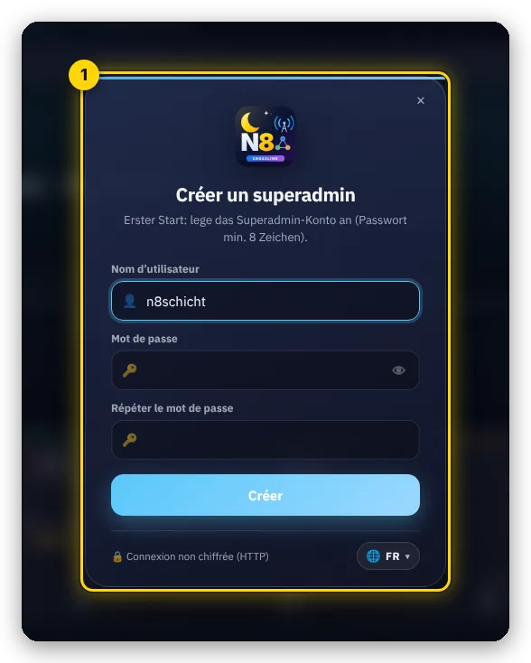
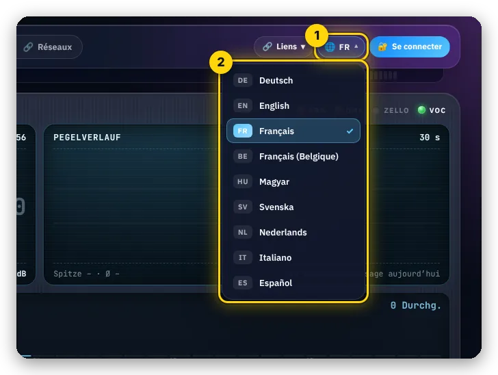
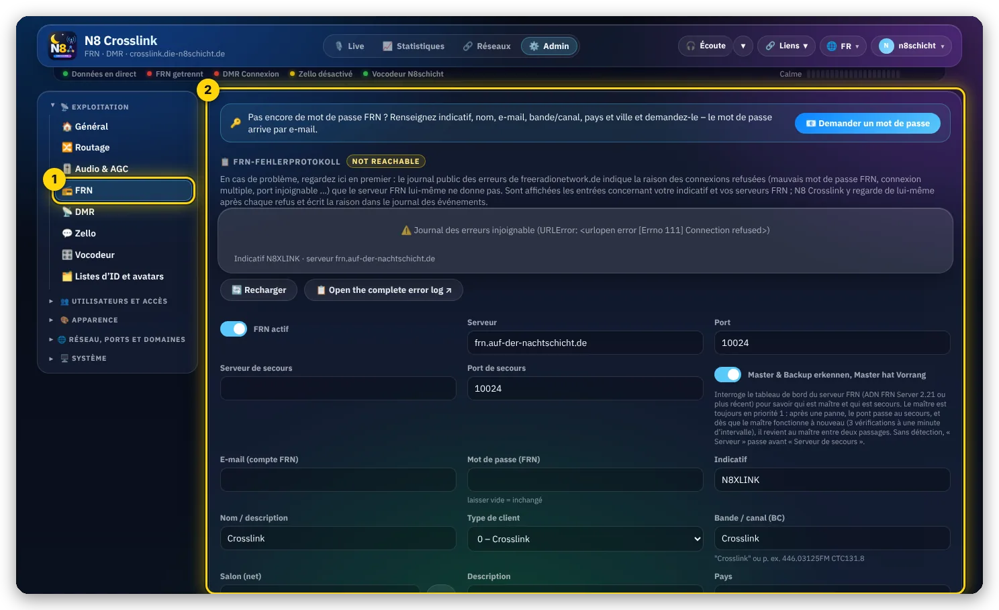
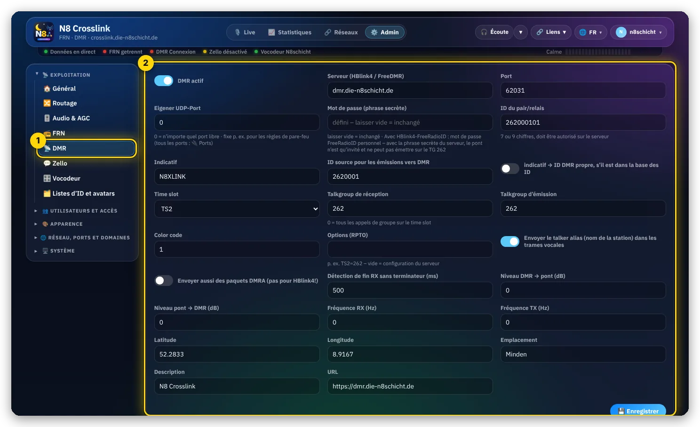
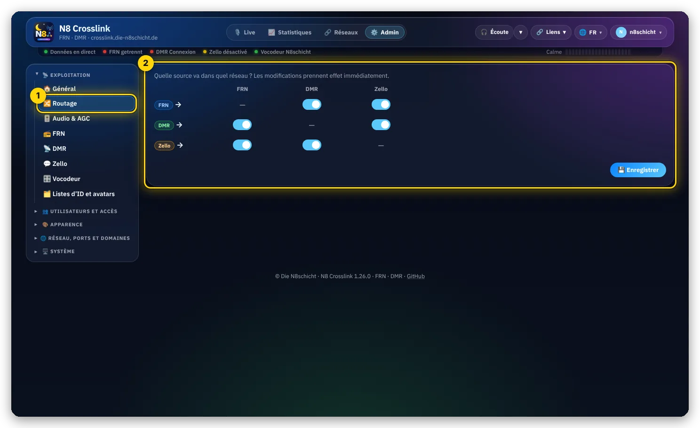
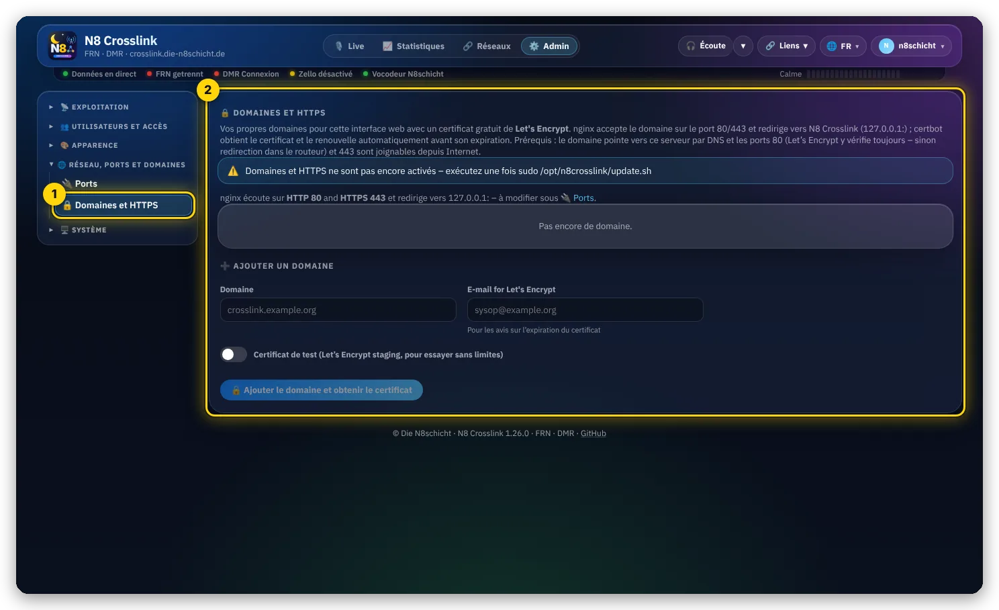
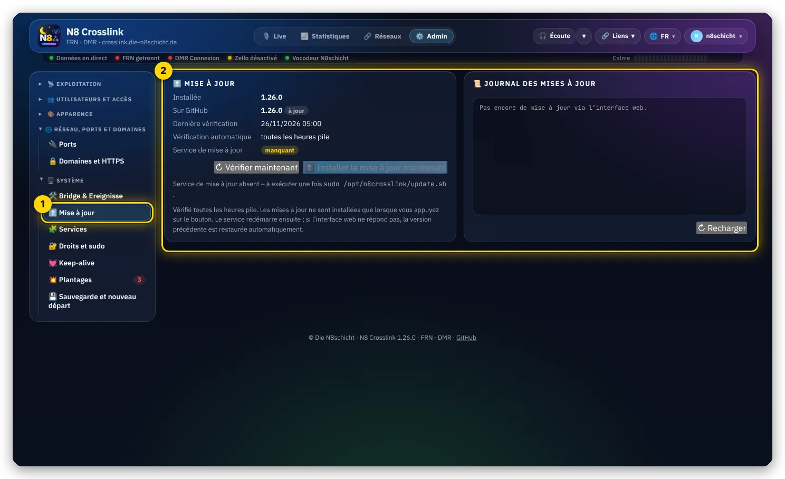
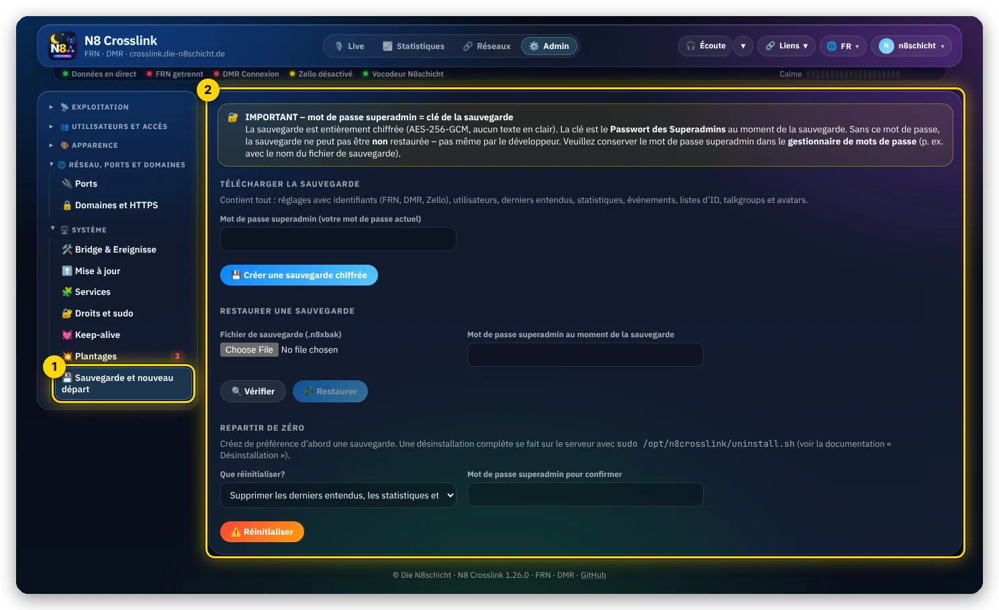

# 📘 N8 Crosslink – Pas à pas

<sub>Langue: [🇩🇪 Deutsch](../de/README.md) · [🇬🇧 English](../en/README.md) · **🇫🇷 Français** · [🇧🇪 Français (Belgique)](../fr-BE/README.md) · [🇭🇺 Magyar](../hu/README.md) · [🇸🇪 Svenska](../sv/README.md) · [🇳🇱 Nederlands](../nl/README.md) · [🇮🇹 Italiano](../it/README.md) · [🇪🇸 Español](../es/README.md)</sub>

N8 Crosslink relie FRN, DMR et Zello en un réseau radio commun. Ce guide vous accompagne dans les premières étapes.

> 💡 Les chiffres jaunes des images correspondent aux chiffres du texte.

## Sommaire

1. [Installer](#1-installer)
2. [Créer le superadmin](#2-créer-le-superadmin)
3. [Choisir la langue](#3-choisir-la-langue)
4. [Connecter FRN](#4-connecter-frn)
5. [Connecter DMR](#5-connecter-dmr)
6. [Définir le routage](#6-définir-le-routage)
7. [Domaine propre avec HTTPS](#7-domaine-propre-avec-https)
8. [Mettre à jour](#8-mettre-à-jour)
9. [Sauvegarder et repartir de zéro](#9-sauvegarder-et-repartir-de-zéro)

## 1. Installer

Sur un ordinateur Debian ou Ubuntu (y compris Raspberry Pi) avec les droits sudo :

```bash
git clone https://github.com/dhartmann1979/N8Crosslink.git
cd N8Crosslink
sudo ./install.sh
```

L’installateur configure le programme, le service, le vocodeur et les droits sous `/opt/n8crosslink`. Ensuite, l’interface est accessible sous `http://<ordinateur>:8080`.

## 2. Créer le superadmin

<p align="center"></p>

Lors du premier accès, **Créer un superadmin** ① apparaît : nom d’utilisateur et mot de passe d’au moins 8 caractères, à répéter. Ce compte peut tout faire, y compris restaurer des sauvegardes. Par la suite, vous vous connectez dans la même fenêtre.

## 3. Choisir la langue

<p align="center"></p>

En haut à droite, **🌐 FR ▾** ① ouvre le menu des langues ② avec neuf langues. Le choix s’applique immédiatement et à toutes les interfaces N8 de ce serveur. Lors de la première visite, la langue du navigateur est utilisée.

## 4. Connecter FRN

<p align="center"></p>

Dans l’espace admin, sous **📡 Exploitation → 📻 FRN** ①, saisissez serveur, port, e-mail et mot de passe FRN ②. Choisissez le **salon** dans la liste lue directement depuis le serveur FRN. Pas encore de mot de passe FRN ? Il peut être demandé ici au SystemManager.

## 5. Connecter DMR

<p align="center"></p>

Sous **📡 DMR** ① se trouvent le serveur DMR, l’ID de pair, le mot de passe et les talkgroups ②. Avec HBlink4-FreeRadioID, le mot de passe est votre mot de passe FreeRadioID personnel – avec la phrase secrète du serveur, le pont n’est qu’invité et ne peut pas émettre sur tous les talkgroups.

## 6. Définir le routage

<p align="center"></p>

Sous **🔀 Routage** ①, déterminez quelle source va dans quel réseau ②, p. ex. FRN → DMR et DMR → FRN. Un temps de verrouillage après l’émission empêche le ping-pong entre les réseaux. Les modifications s’appliquent immédiatement.

## 7. Domaine propre avec HTTPS

<p align="center"></p>

Sous **🌐 Réseau, ports et domaines → 🔒 Domaines et HTTPS** ①, saisissez un domaine qui pointe vers le serveur par DNS, ainsi qu’une adresse e-mail pour Let’s Encrypt ②. Le certificat est obtenu et renouvelé automatiquement. Les ports 80 et 443 doivent être joignables depuis Internet.

## 8. Mettre à jour

<p align="center"></p>

Sous **🖥️ Système → ⬆️ Mise à jour** ①, vous voyez la version installée et si GitHub en propose une plus récente ②. **⬆️ Installer la mise à jour maintenant** la télécharge, vérifie ensuite l’interface web et restaure automatiquement la version précédente en cas de problème. Aucun mot de passe n’est nécessaire.

## 9. Sauvegarder et repartir de zéro

<p align="center"></p>

Sous **🖥️ Système → 💾 Sauvegarde et nouveau départ** ①, créez une sauvegarde chiffrée ② – la clé est le mot de passe superadmin au moment de la sauvegarde. Les statistiques ou tous les réglages peuvent aussi être réinitialisés ici.

---

📖 Description détaillée (allemand): [docs/INSTALLATION.md](../../../docs/INSTALLATION.md)
