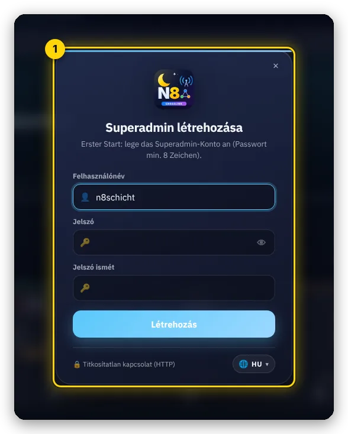
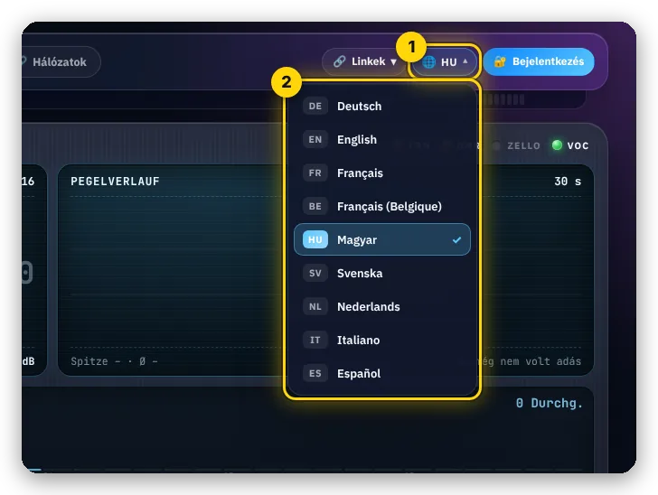
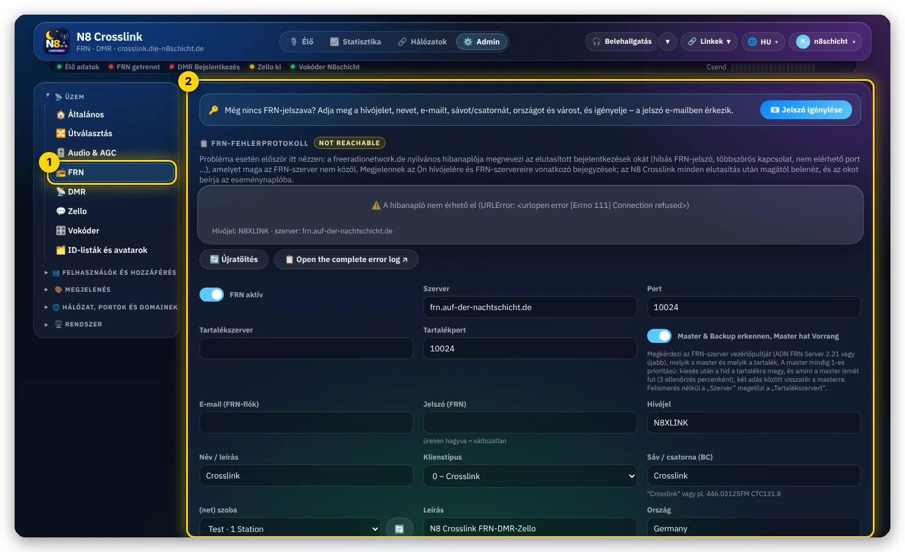
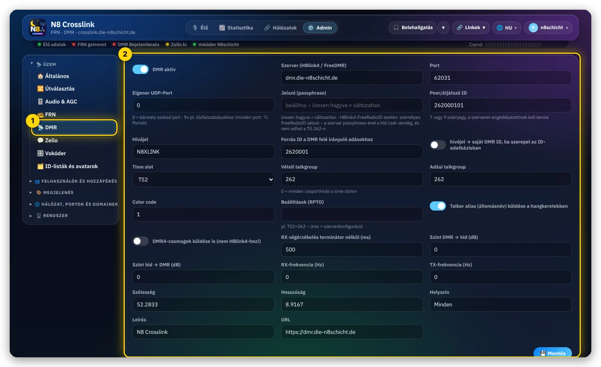
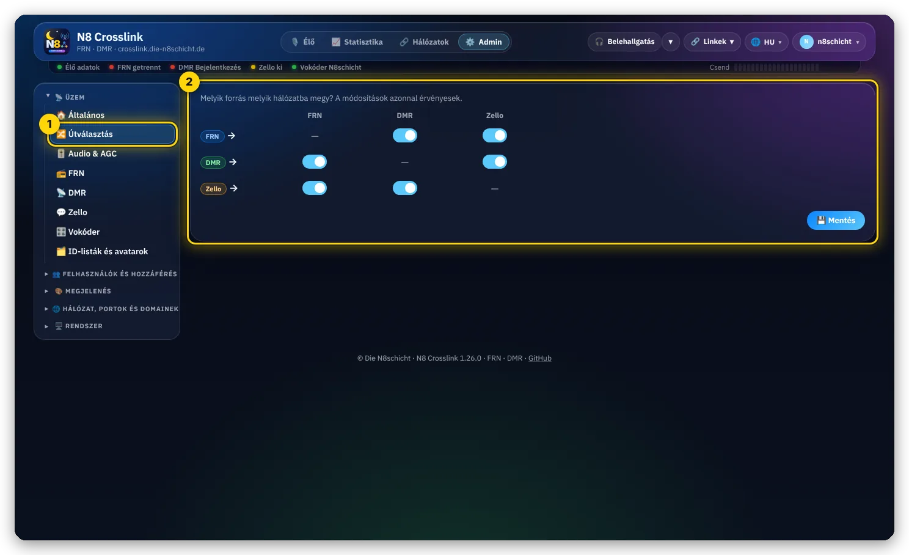
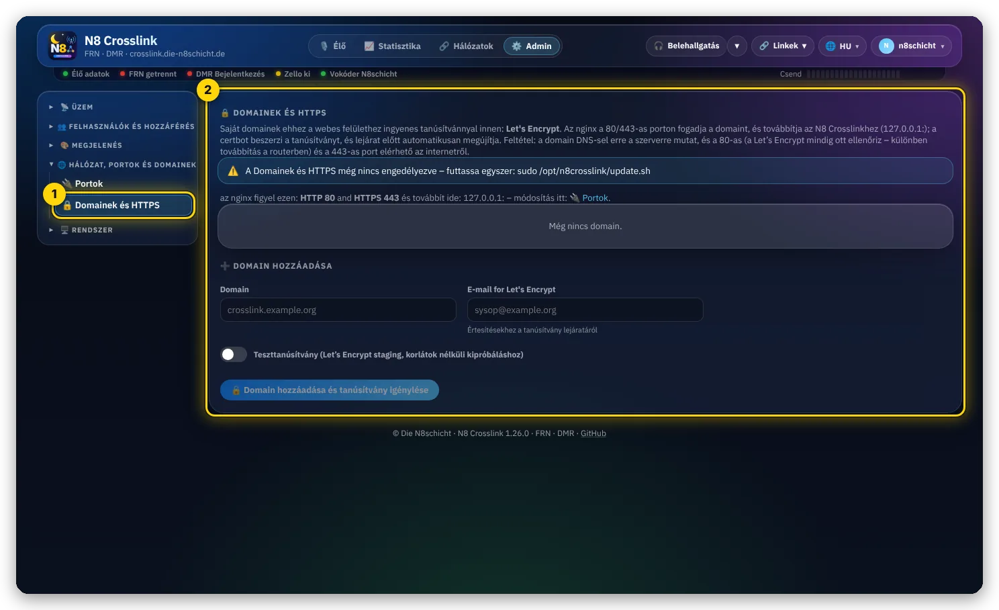
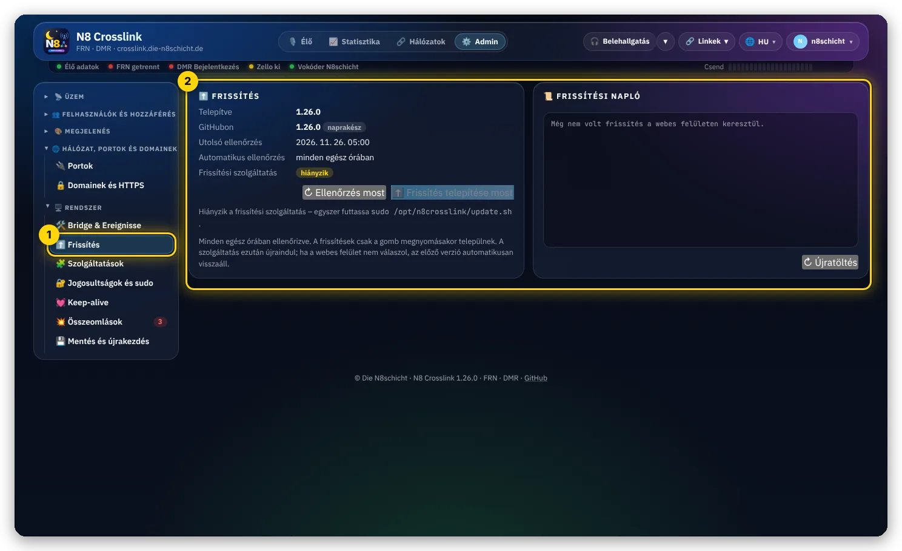
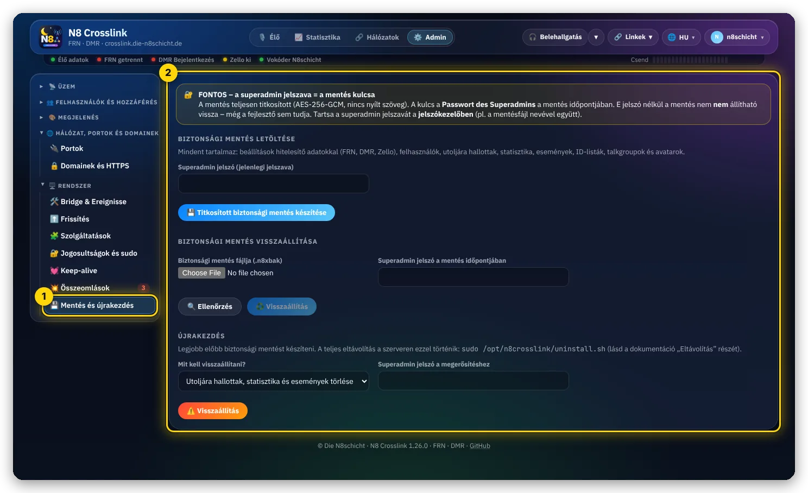

# 📘 N8 Crosslink – Lépésről lépésre

<sub>Nyelv: [🇩🇪 Deutsch](../de/README.md) · [🇬🇧 English](../en/README.md) · [🇫🇷 Français](../fr/README.md) · [🇧🇪 Français (Belgique)](../fr-BE/README.md) · **🇭🇺 Magyar** · [🇸🇪 Svenska](../sv/README.md) · [🇳🇱 Nederlands](../nl/README.md) · [🇮🇹 Italiano](../it/README.md) · [🇪🇸 Español](../es/README.md)</sub>

Az N8 Crosslink az FRN-t, a DMR-t és a Zellót egy közös rádióhálózattá köti össze. Ez az útmutató végigvezet az első lépéseken.

> 💡 A képeken lévő sárga számok a szövegben szereplő számokhoz tartoznak.

## Tartalom

1. [Telepítés](#1-telepítés)
2. [Superadmin létrehozása](#2-superadmin-létrehozása)
3. [Nyelv kiválasztása](#3-nyelv-kiválasztása)
4. [FRN csatlakoztatása](#4-frn-csatlakoztatása)
5. [DMR csatlakoztatása](#5-dmr-csatlakoztatása)
6. [Útválasztás beállítása](#6-útválasztás-beállítása)
7. [Saját domain HTTPS-sel](#7-saját-domain-https-sel)
8. [Frissítés](#8-frissítés)
9. [Mentés és újrakezdés](#9-mentés-és-újrakezdés)

## 1. Telepítés

Debian vagy Ubuntu gépen (Raspberry Pi-n is) sudo-jogosultsággal:

```bash
git clone https://github.com/dhartmann1979/N8Crosslink.git
cd N8Crosslink
sudo ./install.sh
```

A telepítő a `/opt/n8crosslink` alá telepíti a programot, a szolgáltatást, a vokódert és a jogosultságokat. Utána a felület itt érhető el: `http://<gép>:8080`.

## 2. Superadmin létrehozása

<p align="center"></p>

Az első megnyitáskor megjelenik a **Superadmin létrehozása** ①: felhasználónév és legalább 8 karakteres jelszó, majd annak megismétlése. Ez a fiók mindent megtehet, a mentések visszaállítását is. Később ugyanebben az ablakban jelentkezik be.

## 3. Nyelv kiválasztása

<p align="center"></p>

Jobbra fent a **🌐 HU ▾** ① megnyitja a nyelvi menüt ② kilenc nyelvvel. A választás azonnal érvényes, és a szerver összes N8-felületére vonatkozik. Az első látogatáskor a böngésző nyelve érvényes.

## 4. FRN csatlakoztatása

<p align="center"></p>

Az admin területen az **📡 Üzem → 📻 FRN** alatt ① adja meg a szervert, a portot, az e-mail-címet és az FRN-jelszót ②. A **szobát** a közvetlenül az FRN-szerverről beolvasott listából választhatja ki. Még nincs FRN-jelszava? Itt igényelhet a SystemManagertől.

## 5. DMR csatlakoztatása

<p align="center"></p>

A **📡 DMR** alatt ① található a DMR-szerver, a peer ID, a jelszó és a talkgroupok ②. HBlink4-FreeRadioID esetén a jelszó az Ön személyes FreeRadioID-jelszava – a szerver passphrase-ével a híd csak vendég, és nem adhat minden talkgroupon.

## 6. Útválasztás beállítása

<p align="center"></p>

Az **🔀 Útválasztás** alatt ① határozza meg, melyik forrás melyik hálózatba megy ②, pl. FRN → DMR és DMR → FRN. Az adás utáni zárolási idő megakadályozza a pingpongot a hálózatok között. A módosítások azonnal érvényesek.

## 7. Saját domain HTTPS-sel

<p align="center"></p>

A **🌐 Hálózat, portok és domainek → 🔒 Domainek és HTTPS** alatt ① adjon meg egy domaint, amely DNS-sel a szerverre mutat, valamint egy e-mail-címet a Let’s Encrypt számára ②. A tanúsítvány beszerzése és megújítása automatikus. A 80-as és 443-as portnak elérhetőnek kell lennie az internetről.

## 8. Frissítés

<p align="center"></p>

A **🖥️ Rendszer → ⬆️ Frissítés** alatt ① látja a telepített verziót, és hogy van-e újabb a GitHubon ②. A **⬆️ Frissítés telepítése most** letölti, majd ellenőrzi a webes felületet, és hiba esetén automatikusan visszaállítja az előző verziót. Ehhez nem kell jelszó.

## 9. Mentés és újrakezdés

<p align="center"></p>

A **🖥️ Rendszer → 💾 Mentés és újrakezdés** alatt ① titkosított mentést készíthet ② – a kulcs a superadmin jelszava a mentés időpontjában. Itt a statisztika vagy az összes beállítás is visszaállítható.

---

📖 Részletes leírás (német): [docs/INSTALLATION.md](../../../docs/INSTALLATION.md)
