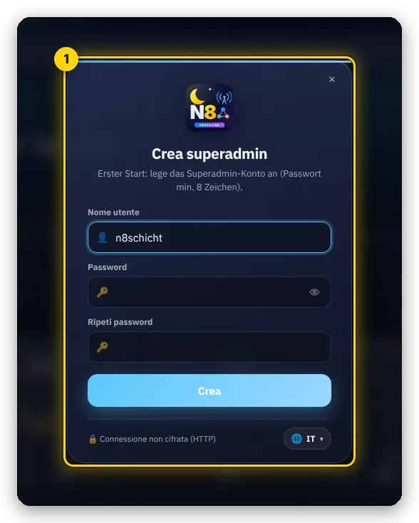
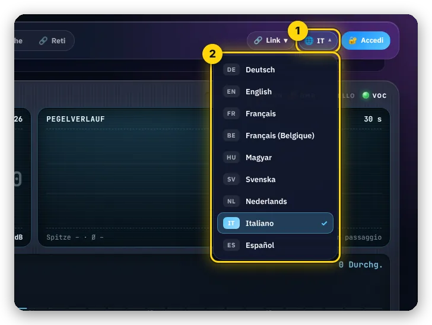
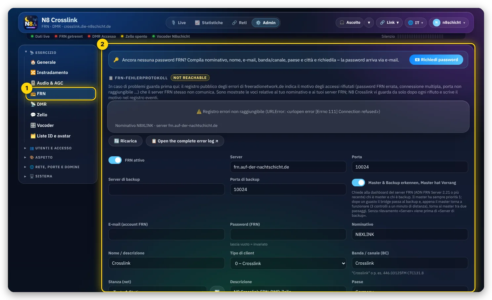
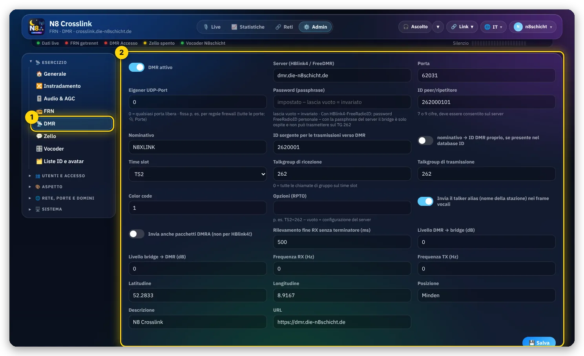
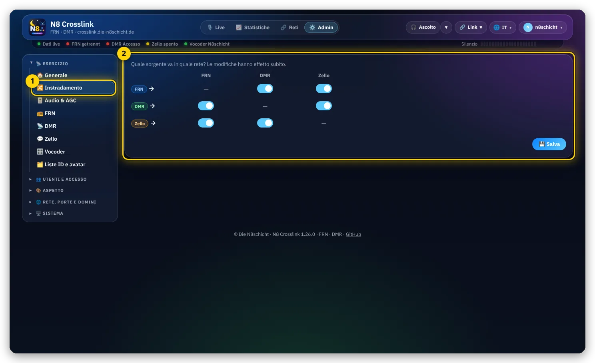
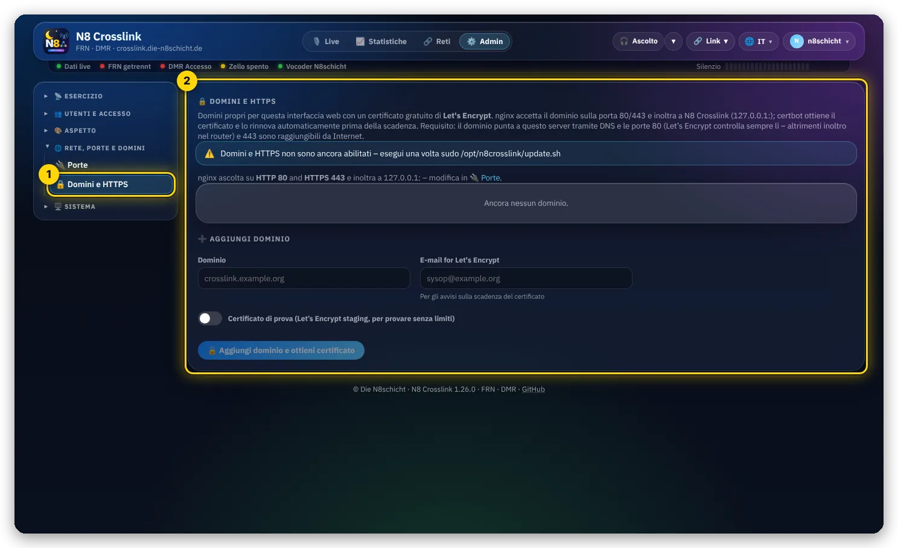
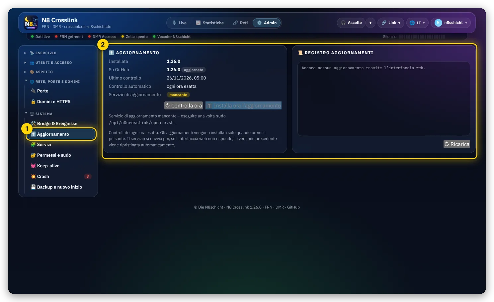
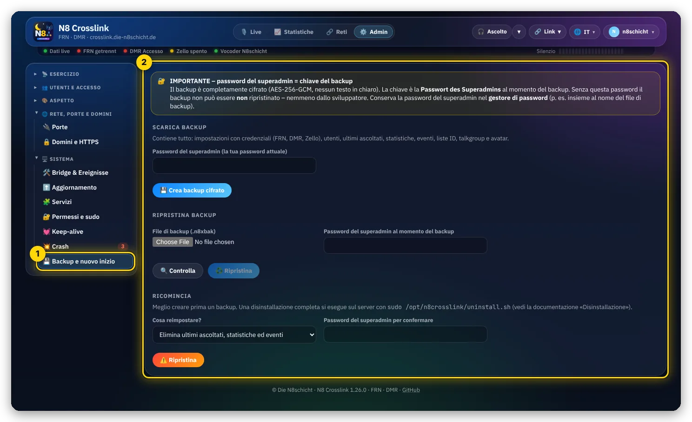

# 📘 N8 Crosslink – Passo dopo passo

<sub>Lingua: [🇩🇪 Deutsch](../de/README.md) · [🇬🇧 English](../en/README.md) · [🇫🇷 Français](../fr/README.md) · [🇧🇪 Français (Belgique)](../fr-BE/README.md) · [🇭🇺 Magyar](../hu/README.md) · [🇸🇪 Svenska](../sv/README.md) · [🇳🇱 Nederlands](../nl/README.md) · **🇮🇹 Italiano** · [🇪🇸 Español](../es/README.md)</sub>

N8 Crosslink collega FRN, DMR e Zello in un’unica rete radio comune. Questa guida ti accompagna nei primi passi.

> 💡 I numeri gialli nelle immagini corrispondono ai numeri nel testo.

## Indice

1. [Installare](#1-installare)
2. [Creare il superadmin](#2-creare-il-superadmin)
3. [Scegliere la lingua](#3-scegliere-la-lingua)
4. [Collegare FRN](#4-collegare-frn)
5. [Collegare DMR](#5-collegare-dmr)
6. [Impostare l’instradamento](#6-impostare-linstradamento)
7. [Dominio proprio con HTTPS](#7-dominio-proprio-con-https)
8. [Aggiornare](#8-aggiornare)
9. [Backup e nuovo inizio](#9-backup-e-nuovo-inizio)

## 1. Installare

Su un computer Debian o Ubuntu (anche Raspberry Pi) con diritti sudo:

```bash
git clone https://github.com/dhartmann1979/N8Crosslink.git
cd N8Crosslink
sudo ./install.sh
```

L’installer configura programma, servizio, vocoder e permessi in `/opt/n8crosslink`. Dopo l’interfaccia è raggiungibile su `http://<computer>:8080`.

## 2. Creare il superadmin

<p align="center"></p>

Alla prima apertura compare **Crea superadmin** ①: nome utente e una password di almeno 8 caratteri, poi ripetila. Questo account può fare tutto, anche ripristinare i backup. In seguito accedi nella stessa finestra.

## 3. Scegliere la lingua

<p align="center"></p>

In alto a destra **🌐 IT ▾** ① apre il menu delle lingue ② con nove lingue. La scelta vale subito e per tutte le interfacce N8 di questo server. Alla prima visita viene usata la lingua del browser.

## 4. Collegare FRN

<p align="center"></p>

Nell’area admin, in **📡 Esercizio → 📻 FRN** ①, inserisci server, porta, e-mail e password FRN ②. La **stanza** si sceglie dalla lista letta direttamente dal server FRN. Ancora nessuna password FRN? Si può richiedere qui al SystemManager.

## 5. Collegare DMR

<p align="center"></p>

In **📡 DMR** ① trovi server DMR, ID peer, password e talkgroup ②. Con HBlink4-FreeRadioID la password è la tua password FreeRadioID personale – con la passphrase del server il bridge è solo ospite e non può trasmettere su tutti i talkgroup.

## 6. Impostare l’instradamento

<p align="center"></p>

In **🔀 Instradamento** ① stabilisci quale sorgente va in quale rete ②, p. es. FRN → DMR e DMR → FRN. Un tempo di blocco dopo la trasmissione evita il ping-pong tra le reti. Le modifiche hanno effetto subito.

## 7. Dominio proprio con HTTPS

<p align="center"></p>

In **🌐 Rete, porte e domini → 🔒 Domini e HTTPS** ① inserisci un dominio che punta al server tramite DNS e un indirizzo e-mail per Let’s Encrypt ②. Il certificato viene ottenuto e rinnovato automaticamente. Le porte 80 e 443 devono essere raggiungibili da Internet.

## 8. Aggiornare

<p align="center"></p>

In **🖥️ Sistema → ⬆️ Aggiornamento** ① vedi la versione installata e se GitHub ne ha una più recente ②. **⬆️ Installa ora l’aggiornamento** la scarica, poi controlla l’interfaccia web e in caso di errore ripristina automaticamente la versione precedente. Non serve alcuna password.

## 9. Backup e nuovo inizio

<p align="center"></p>

In **🖥️ Sistema → 💾 Backup e nuovo inizio** ① crei un backup cifrato ② – la chiave è la password del superadmin al momento del backup. Qui si possono anche reimpostare le statistiche o tutte le impostazioni.

---

📖 Descrizione dettagliata (tedesco): [docs/INSTALLATION.md](../../../docs/INSTALLATION.md)
