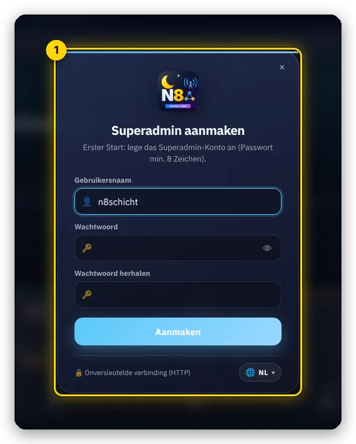
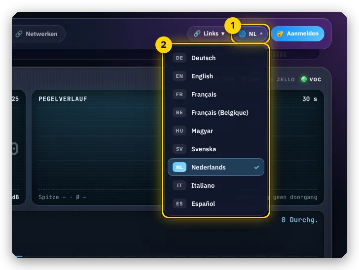
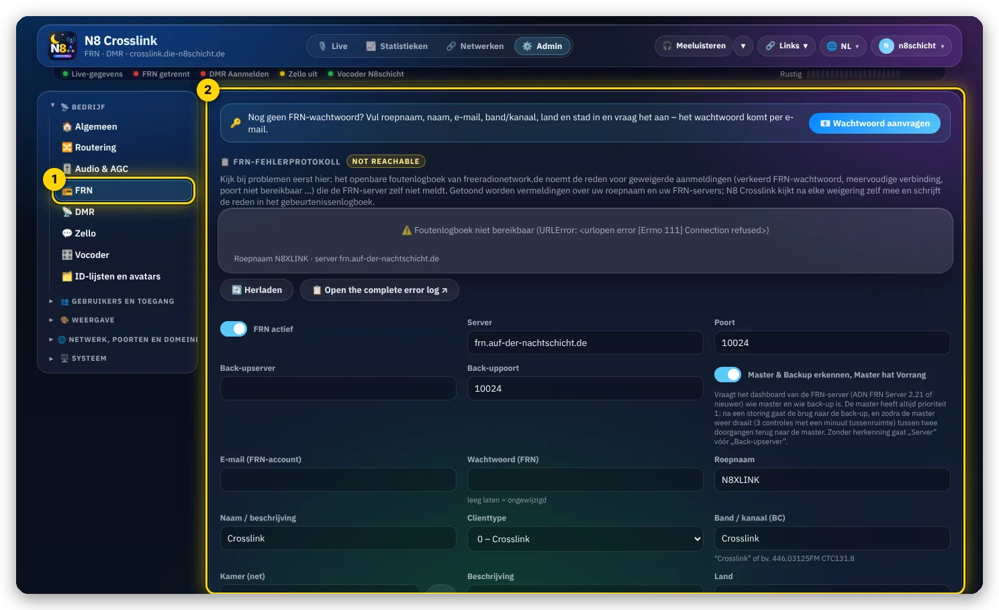
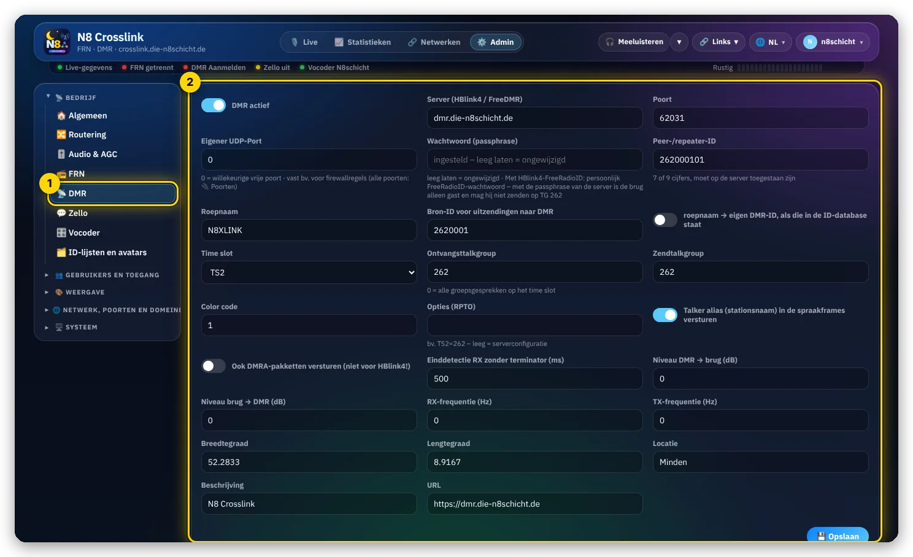
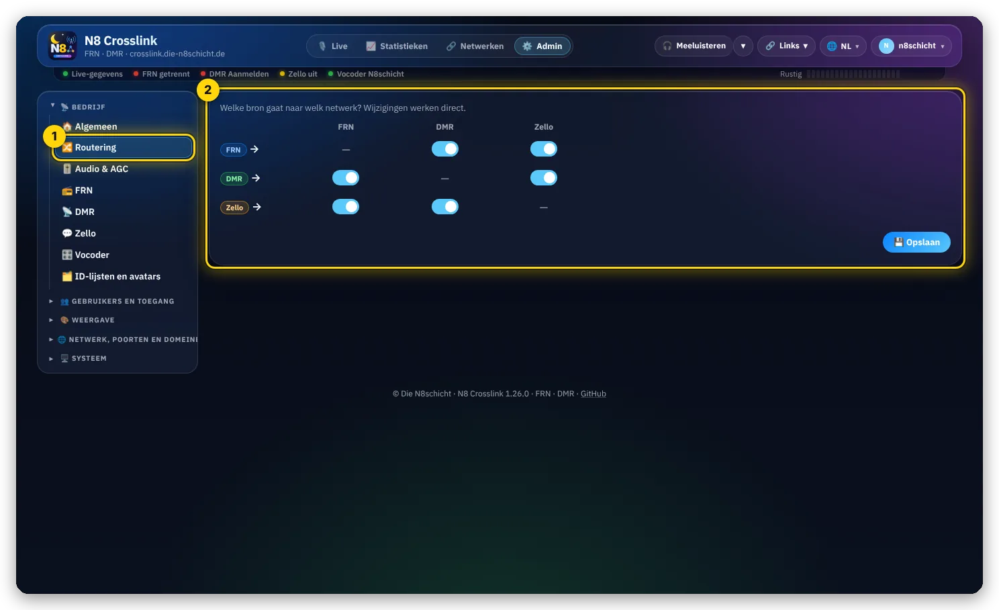
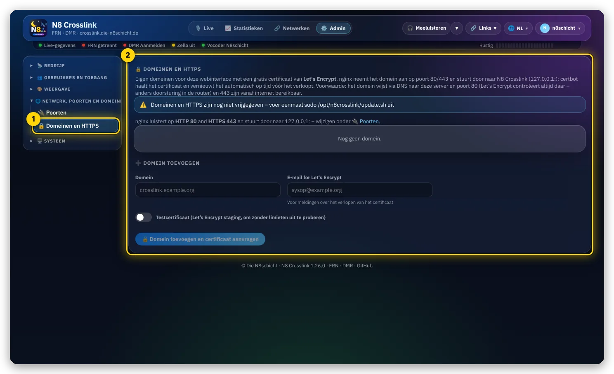
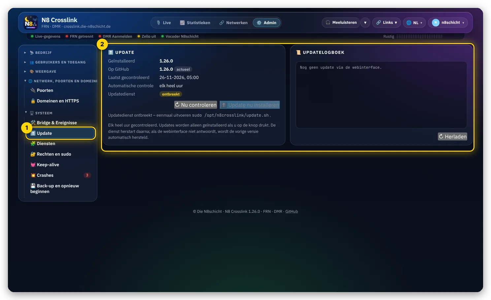
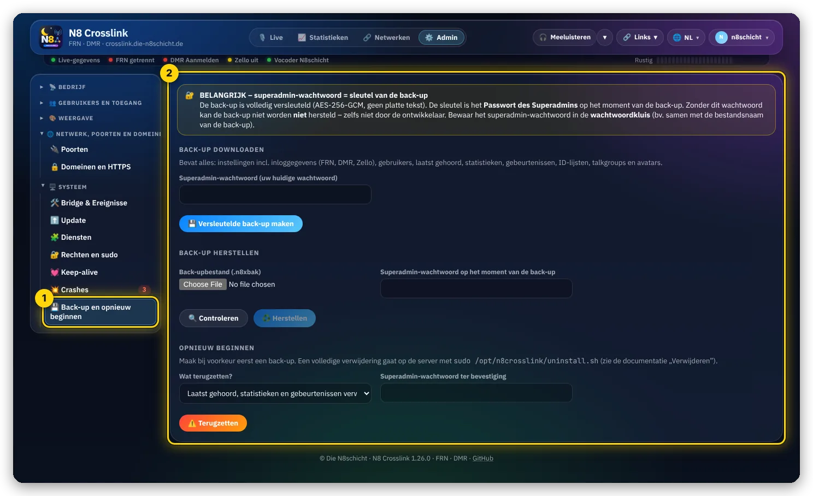

# 📘 N8 Crosslink – Stap voor stap

<sub>Taal: [🇩🇪 Deutsch](../de/README.md) · [🇬🇧 English](../en/README.md) · [🇫🇷 Français](../fr/README.md) · [🇧🇪 Français (Belgique)](../fr-BE/README.md) · [🇭🇺 Magyar](../hu/README.md) · [🇸🇪 Svenska](../sv/README.md) · **🇳🇱 Nederlands** · [🇮🇹 Italiano](../it/README.md) · [🇪🇸 Español](../es/README.md)</sub>

N8 Crosslink verbindt FRN, DMR en Zello tot één gemeenschappelijk radionetwerk. Deze handleiding leidt u door de eerste stappen.

> 💡 De gele cijfers in de afbeeldingen horen bij de cijfers in de tekst.

## Inhoud

1. [Installeren](#1-installeren)
2. [Superadmin aanmaken](#2-superadmin-aanmaken)
3. [Taal kiezen](#3-taal-kiezen)
4. [FRN verbinden](#4-frn-verbinden)
5. [DMR verbinden](#5-dmr-verbinden)
6. [De routering vastleggen](#6-de-routering-vastleggen)
7. [Eigen domein met HTTPS](#7-eigen-domein-met-https)
8. [Bijwerken](#8-bijwerken)
9. [Back-up en opnieuw beginnen](#9-back-up-en-opnieuw-beginnen)

## 1. Installeren

Op een Debian- of Ubuntu-computer (ook Raspberry Pi) met sudo-rechten:

```bash
git clone https://github.com/dhartmann1979/N8Crosslink.git
cd N8Crosslink
sudo ./install.sh
```

Het installatieprogramma richt programma, dienst, vocoder en rechten in onder `/opt/n8crosslink`. Daarna is de interface bereikbaar op `http://<computer>:8080`.

## 2. Superadmin aanmaken

<p align="center"></p>

Bij het eerste bezoek verschijnt **Superadmin aanmaken** ①: gebruikersnaam en een wachtwoord van minstens 8 tekens, daarna herhalen. Dit account mag alles, ook back-ups herstellen. Later meldt u zich in hetzelfde venster aan.

## 3. Taal kiezen

<p align="center"></p>

Rechtsboven opent **🌐 NL ▾** ① het taalmenu ② met negen talen. De keuze geldt direct en voor alle N8-interfaces op deze server. Bij het eerste bezoek wordt de taal van de browser gebruikt.

## 4. FRN verbinden

<p align="center"></p>

In het beheergedeelte onder **📡 Bedrijf → 📻 FRN** ① voert u server, poort, e-mail en FRN-wachtwoord in ②. De **kamer** kiest u uit de lijst die direct van de FRN-server wordt gelezen. Nog geen FRN-wachtwoord? Dat kunt u hier bij de SystemManager aanvragen.

## 5. DMR verbinden

<p align="center"></p>

Onder **📡 DMR** ① staan DMR-server, peer-ID, wachtwoord en talkgroups ②. Bij HBlink4-FreeRadioID is het wachtwoord uw persoonlijke FreeRadioID-wachtwoord – met de passphrase van de server is de brug alleen gast en mag hij niet op alle talkgroups zenden.

## 6. De routering vastleggen

<p align="center"></p>

Onder **🔀 Routering** ① legt u vast welke bron naar welk netwerk gaat ②, bv. FRN → DMR en DMR → FRN. Een vergrendeltijd na het zenden voorkomt pingpong tussen de netwerken. Wijzigingen werken direct.

## 7. Eigen domein met HTTPS

<p align="center"></p>

Onder **🌐 Netwerk, poorten en domeinen → 🔒 Domeinen en HTTPS** ① voert u een domein in dat via DNS naar de server wijst, plus een e-mailadres voor Let’s Encrypt ②. Het certificaat wordt automatisch opgehaald en vernieuwd. Poorten 80 en 443 moeten vanaf internet bereikbaar zijn.

## 8. Bijwerken

<p align="center"></p>

Onder **🖥️ Systeem → ⬆️ Update** ① ziet u de geïnstalleerde versie en of GitHub een nieuwere heeft ②. **⬆️ Update nu installeren** downloadt hem, controleert daarna de webinterface en zet bij een fout automatisch de vorige versie terug. Hiervoor is geen wachtwoord nodig.

## 9. Back-up en opnieuw beginnen

<p align="center"></p>

Onder **🖥️ Systeem → 💾 Back-up en opnieuw beginnen** ① maakt u een versleutelde back-up ② – de sleutel is het superadmin-wachtwoord op het moment van de back-up. Hier kunt u ook statistieken of alle instellingen terugzetten.

---

📖 Uitgebreide beschrijving (Duits): [docs/INSTALLATION.md](../../../docs/INSTALLATION.md)
