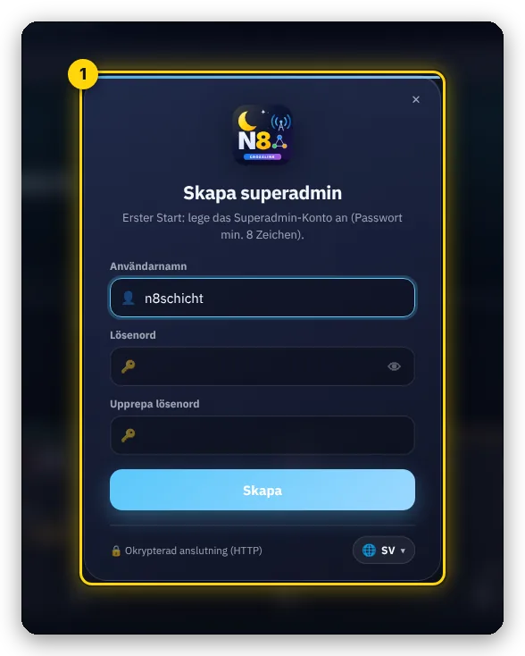
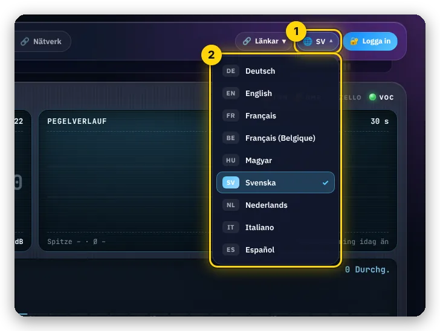
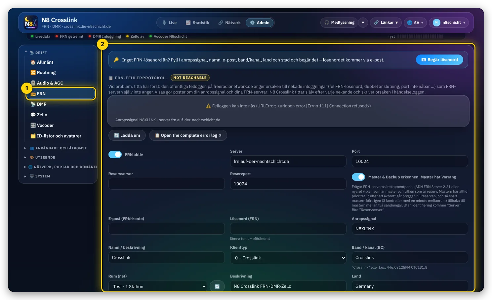
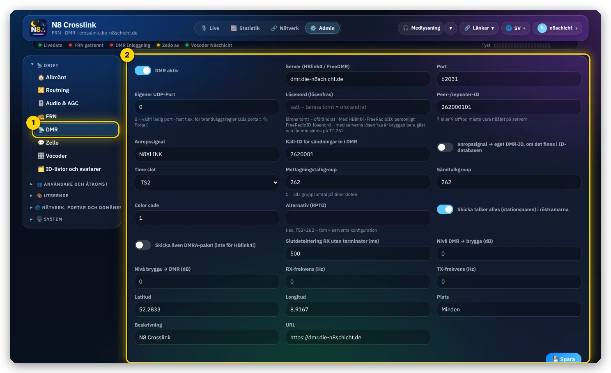
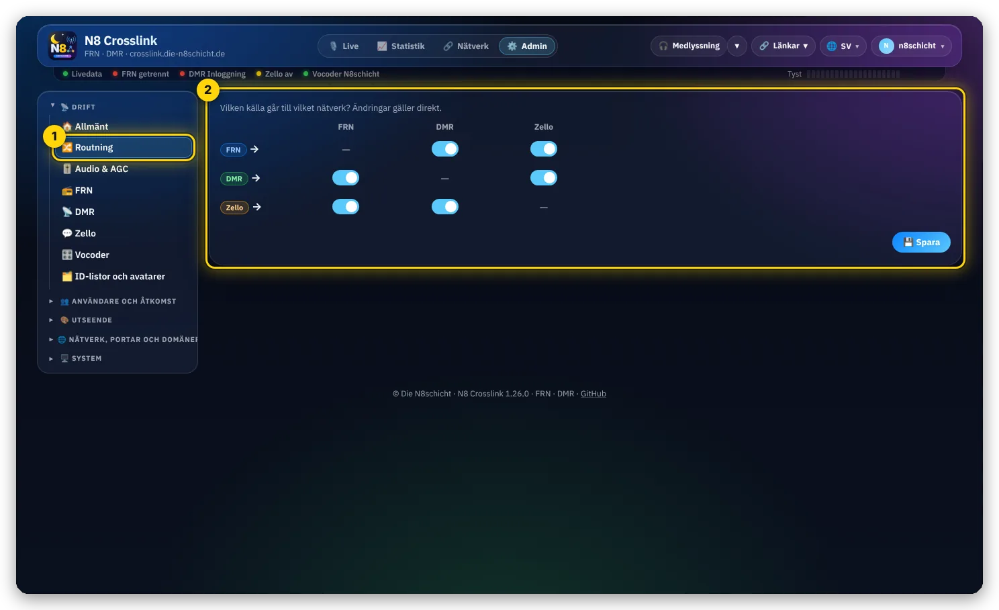
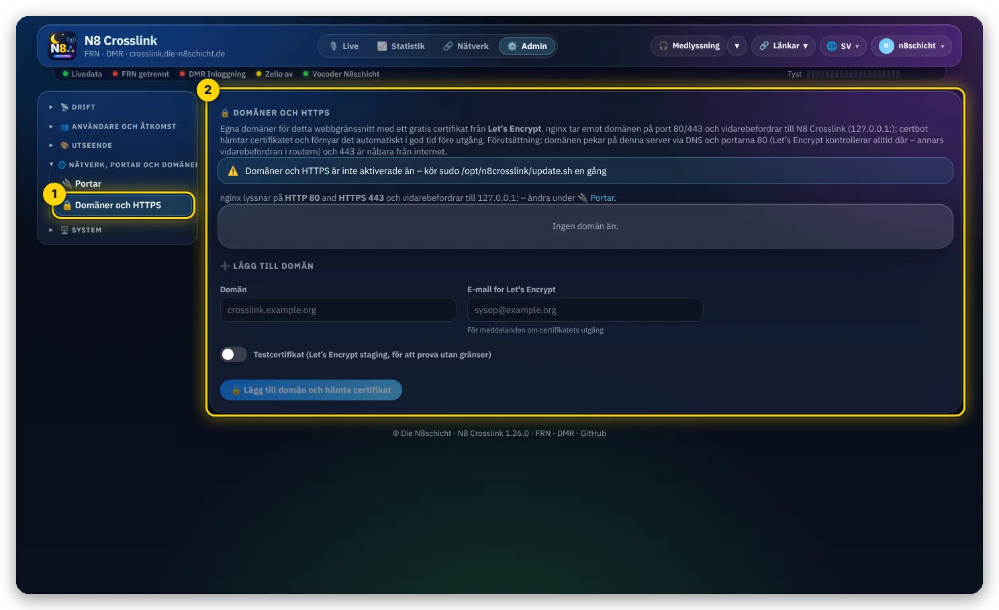
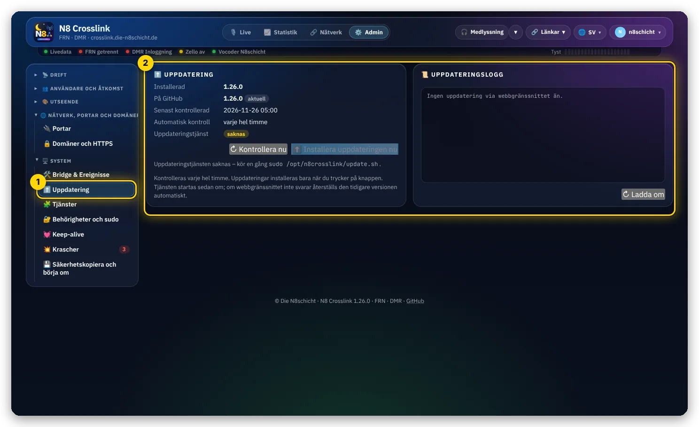
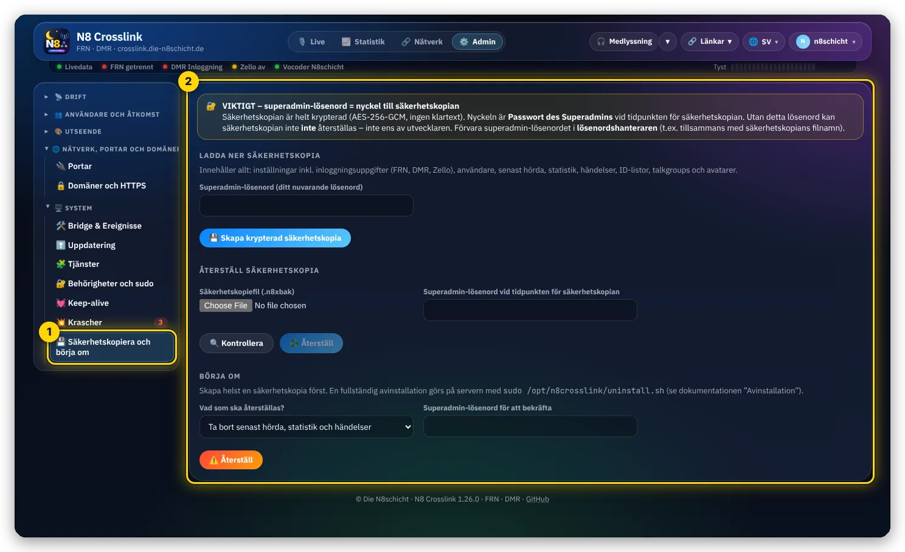

# 📘 N8 Crosslink – Steg för steg

<sub>Språk: [🇩🇪 Deutsch](../de/README.md) · [🇬🇧 English](../en/README.md) · [🇫🇷 Français](../fr/README.md) · [🇧🇪 Français (Belgique)](../fr-BE/README.md) · [🇭🇺 Magyar](../hu/README.md) · **🇸🇪 Svenska** · [🇳🇱 Nederlands](../nl/README.md) · [🇮🇹 Italiano](../it/README.md) · [🇪🇸 Español](../es/README.md)</sub>

N8 Crosslink förbinder FRN, DMR och Zello till ett gemensamt radionät. Denna guide tar dig genom de första stegen.

> 💡 De gula siffrorna i bilderna hör till siffrorna i texten.

## Innehåll

1. [Installera](#1-installera)
2. [Skapa superadmin](#2-skapa-superadmin)
3. [Välj språk](#3-välj-språk)
4. [Anslut FRN](#4-anslut-frn)
5. [Anslut DMR](#5-anslut-dmr)
6. [Ställ in routningen](#6-ställ-in-routningen)
7. [Egen domän med HTTPS](#7-egen-domän-med-https)
8. [Uppdatera](#8-uppdatera)
9. [Säkerhetskopiera och börja om](#9-säkerhetskopiera-och-börja-om)

## 1. Installera

På en Debian- eller Ubuntu-dator (även Raspberry Pi) med sudo-rättigheter:

```bash
git clone https://github.com/dhartmann1979/N8Crosslink.git
cd N8Crosslink
sudo ./install.sh
```

Installationsprogrammet sätter upp program, tjänst, vocoder och behörigheter under `/opt/n8crosslink`. Därefter nås gränssnittet på `http://<dator>:8080`.

## 2. Skapa superadmin

<p align="center"></p>

Vid första besöket visas **Skapa superadmin** ①: användarnamn och ett lösenord på minst 8 tecken, sedan upprepa det. Detta konto får göra allt, även återställa säkerhetskopior. Senare loggar du in i samma fönster.

## 3. Välj språk

<p align="center"></p>

Uppe till höger öppnar **🌐 SV ▾** ① språkmenyn ② med nio språk. Valet gäller direkt och för alla N8-gränssnitt på denna server. Vid första besöket används webbläsarens språk.

## 4. Anslut FRN

<p align="center"></p>

I adminområdet under **📡 Drift → 📻 FRN** ① anger du server, port, e-post och FRN-lösenord ②. **Rummet** väljer du i listan som läses direkt från FRN-servern. Inget FRN-lösenord än? Det kan begäras hos SystemManager här.

## 5. Anslut DMR

<p align="center"></p>

Under **📡 DMR** ① finns DMR-server, peer-ID, lösenord och talkgroups ②. Med HBlink4-FreeRadioID är lösenordet ditt personliga FreeRadioID-lösenord – med serverns lösenfras är bryggan bara gäst och får inte sända på alla talkgroups.

## 6. Ställ in routningen

<p align="center"></p>

Under **🔀 Routning** ① bestämmer du vilken källa som går till vilket nätverk ②, t.ex. FRN → DMR och DMR → FRN. En spärrtid efter sändning förhindrar pingpong mellan nätverken. Ändringar gäller direkt.

## 7. Egen domän med HTTPS

<p align="center"></p>

Under **🌐 Nätverk, portar och domäner → 🔒 Domäner och HTTPS** ① anger du en domän som pekar på servern via DNS, samt en e-postadress för Let’s Encrypt ②. Certifikatet hämtas och förnyas automatiskt. Portarna 80 och 443 måste kunna nås från internet.

## 8. Uppdatera

<p align="center"></p>

Under **🖥️ System → ⬆️ Uppdatering** ① ser du den installerade versionen och om GitHub har en nyare ②. **⬆️ Installera uppdateringen nu** laddar ner den, kontrollerar sedan webbgränssnittet och återställer automatiskt den tidigare versionen om något går fel. Inget lösenord behövs för detta.

## 9. Säkerhetskopiera och börja om

<p align="center"></p>

Under **🖥️ System → 💾 Säkerhetskopiera och börja om** ① skapar du en krypterad säkerhetskopia ② – nyckeln är superadmin-lösenordet vid tidpunkten för säkerhetskopian. Här kan även statistik eller alla inställningar återställas.

---

📖 Utförlig beskrivning (tyska): [docs/INSTALLATION.md](../../../docs/INSTALLATION.md)
